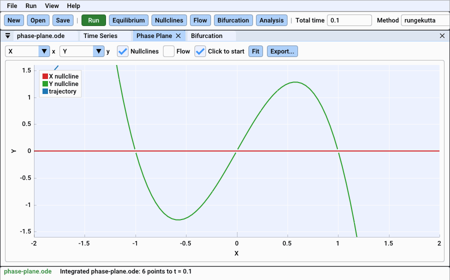
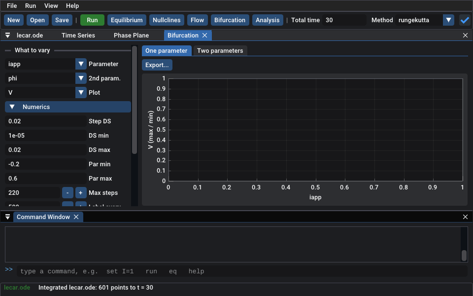
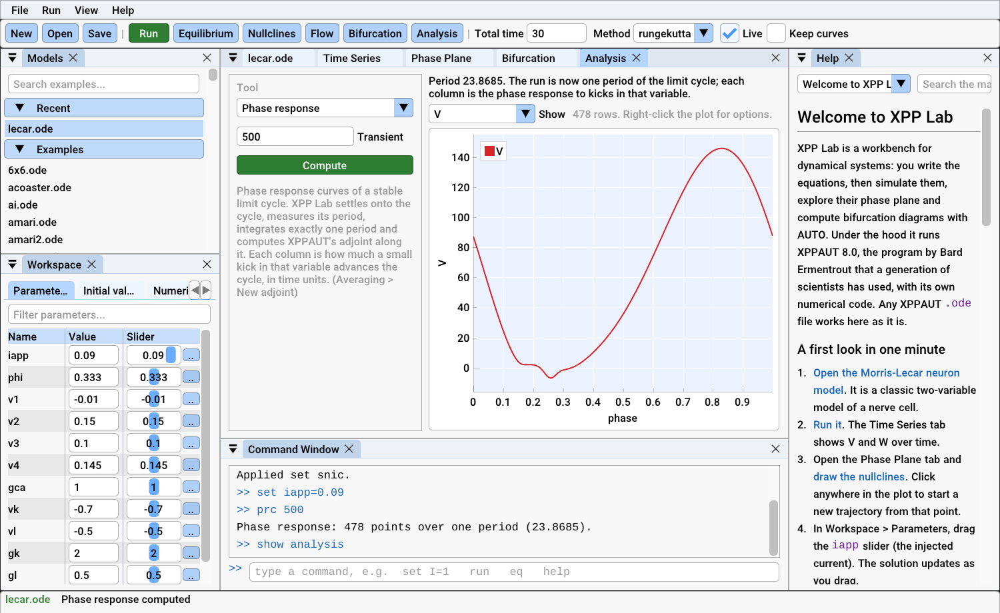
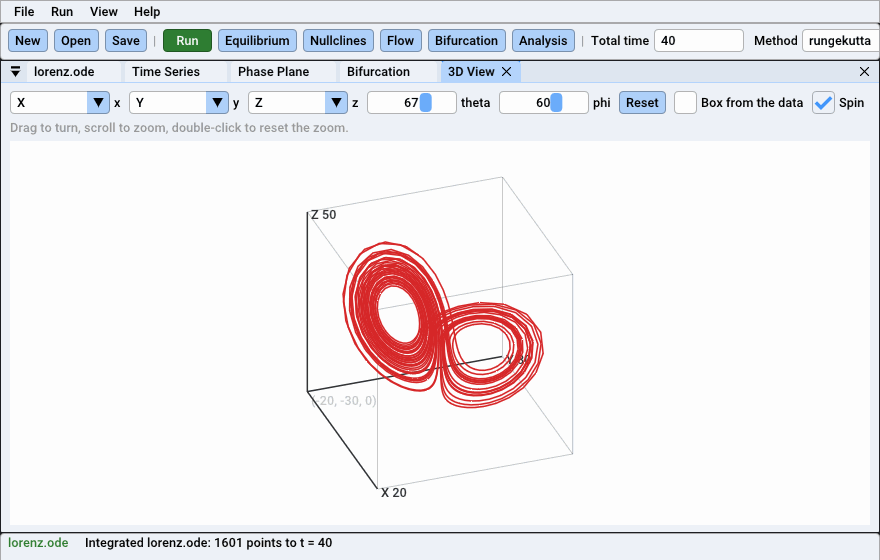
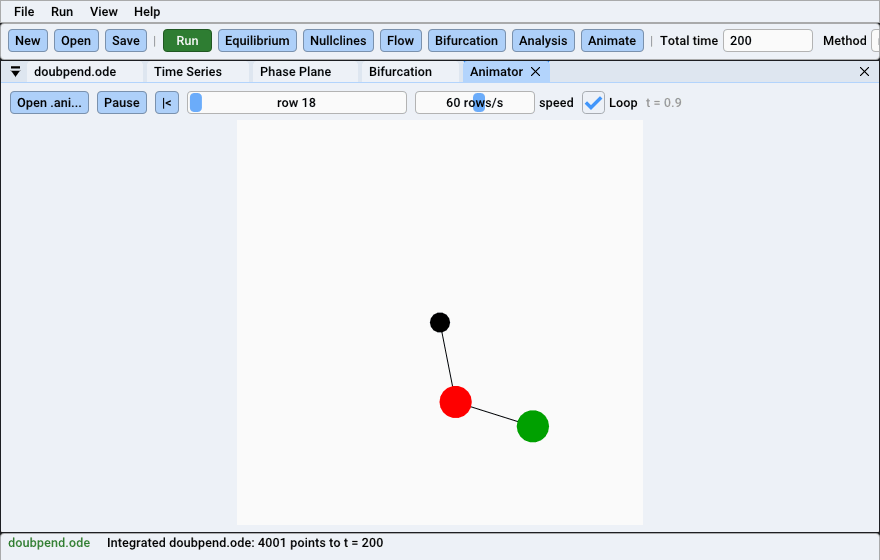

<p align="center">
  
</p>

<h1 align="center">XPP Studio</h1>

<p align="center">
  <b>XPPAUT, modernized.</b><br>
  The trusted XPPAUT and AUTO engine, now a friendly, native app for Windows,
  macOS and Linux, and a Python package.
</p>

<p align="center">
  <a href="https://github.com/CesarPerdomoDiaz/xppstudio/releases/latest"></a>
  <a href="https://github.com/CesarPerdomoDiaz/xppstudio/actions/workflows/ci.yml"></a>
  <a href="https://cesarperdomodiaz.github.io/xppstudio/"></a>
  
  <a href="LICENSE"></a>
</p>

<p align="center">
  
  <br><sub>The Morris-Lecar neuron as the injected current <i>iapp</i> rises and
  falls. Everything follows at once, with no re-running or restarting: the
  nullclines move, the rest state gives way to repetitive firing, and back.</sub>
</p>

## Download

| Your computer | Download | Then |
|---|---|---|
| **Windows** 10 or 11, 64-bit | [XPPStudio-Windows-x64.zip](https://github.com/CesarPerdomoDiaz/xppstudio/releases/latest/download/XPPStudio-Windows-x64.zip) | Unzip it anywhere and run `xppstudio.exe` |
| **macOS** 11 or later, Apple silicon or Intel | [XPPStudio-macOS.dmg](https://github.com/CesarPerdomoDiaz/xppstudio/releases/latest/download/XPPStudio-macOS.dmg) | Open it and drag the app to *Applications* |
| **Linux**, x86-64 | [XPPStudio-Linux-x86_64.tar.gz](https://github.com/CesarPerdomoDiaz/xppstudio/releases/latest/download/XPPStudio-Linux-x86_64.tar.gz) | Unpack it and run `xppstudio` |
| **Python** 3.9 or later | `pip install xppstudio --find-links https://github.com/CesarPerdomoDiaz/xppstudio/releases/expanded_assets/v0.1.0` | `import xppstudio` |

Nothing else is needed: no X server, no compiler, no Terminal. The apps are
not yet signed with a paid certificate, so the first time Windows or macOS
asks you to confirm that you want to open them;
[the install guide](docs/install.md) shows how, and how to check a download.
Every release, with its notes and checksums, is on the
[releases page](https://github.com/CesarPerdomoDiaz/xppstudio/releases).

**First steps:** the Morris-Lecar model opens. Press **Run**, open the
**Phase Plane** tab, tick **Nullclines** and drag the `iapp` slider. Then
press **F1** for the manual and its tutorial.

---

## If you know XPPAUT, you already know XPP Studio

XPP Studio runs **XPPAUT 8.0's own numerical code**: the same
`.ode` files, the same fifteen integrators, the same AUTO with its HB, LP,
BP, PD and TR labels in the same colours. Even the two-key commands still
work: `I G` integrates, `N N` draws nullclines, `S G` finds an equilibrium.

Everything around the engine is new:

| You want to... | Classic XPPAUT | XPP Studio |
|---|---|---|
| Install it on Windows | Install an X server (Xming), Cygwin DLLs, batch files | Unzip and double-click |
| Run it on a Mac | XQuartz, then Gatekeeper workarounds in the terminal | A native app for Apple Silicon and Intel *(preview)* |
| Change a parameter | Open the Parameters window, type, re-run | Drag its slider; the solution updates live |
| Fix a typo in a model | "Illegal syntax", and XPPAUT exits | The editor points at the line and explains |
| Read a model file | Plain text, any editor | Syntax colouring that knows your parameters and variables |
| Follow a bifurcation | AUTO window, nested dialogs, Grab with the mouse | One panel: a table of special points and the continuations that make sense from each |
| Get a phase response curve | Find the period, integrate exactly one cycle, then *Averaging > New adjoint* | Press *Compute*: the cycle, its period and the adjoint are found for you |
| Look at spectra and statistics | One *stocHastic* dialog at a time; the result replaces your data | An Analysis window with every tool beside its plot; your run stays as it was |
| Watch a model move | The Viewer, if your X server cooperates | The Animator plays the model's `.ani` file; the 3D view turns with the mouse |
| Make a figure for a paper | PostScript, then replot elsewhere | PNG as shown, or a vector SVG, in one click |
| Automate an analysis | Batch mode only (no AUTO) | A command window, and Python with AUTO included |
| Learn it | A book and old web pages | A built-in manual with live examples, and tooltips everywhere |

## Made for teaching

Learning XPPAUT and AUTO has always meant fighting the interface before
the mathematics. XPP Studio removes that first wall:

- **Nothing to install** on Windows. The first start opens a classic model
  (Morris-Lecar) so there is something to explore at once.
- **A guided tutorial inside the app.** Its links open the models and run the
  steps ("draw the nullclines", "find the equilibrium") as you read.
- **Every setting explains itself.** Hover over DS, NTST or Par max in the
  bifurcation panel to see what it does and when to change it.
- **Plain words.** Special points read "Hopf bifurcation" or "fold of limit
  cycles", and from each point you choose an action such as "Periodic orbits
  from this Hopf point".
- **Simulation and continuation side by side.** A parameter sweep (XPPAUT's
  *Range*) drops brute-force simulation results right onto AUTO's
  diagram, so students can see that the stable branches are what the
  system actually does.
- **More than 150 example models** from neuroscience, ecology, chemistry and
  mechanics, each with its description.

## A look around

<table>
  <tr>
    <td></td>
    <td></td>
  </tr>
  <tr>
    <td align="center"><sub>Phase plane: start trajectories anywhere, then find the saddle and its manifolds</sub></td>
    <td align="center"><sub>AUTO: steady states and Hopf points, then the periodic orbits (dark theme)</sub></td>
  </tr>
  <tr>
    <td></td>
    <td></td>
  </tr>
  <tr>
    <td align="center"><sub>The editor colours your parameters and variables</sub></td>
    <td align="center"><sub>The built-in manual and tutorial</sub></td>
  </tr>
  <tr>
    <td></td>
    <td></td>
  </tr>
  <tr>
    <td align="center"><sub>Analysis: phase response curves, spectra, histograms, Liapunov exponents, curve fitting</sub></td>
    <td align="center"><sub>The same tools from Python: <code>m.phase_response()</code>, <code>m.spectrum("V")</code></sub></td>
  </tr>
  <tr>
    <td></td>
    <td></td>
  </tr>
  <tr>
    <td align="center"><sub>The 3D view: drag to turn it, or let it spin; models' own 3D settings are honoured</sub></td>
    <td align="center"><sub>The Animator plays XPPAUT's <code>.ani</code> files</sub></td>
  </tr>
</table>

## Python

```python
import xppstudio as xs

m = xs.load("lecar.ode")              # any XPPAUT model file
m.parameters["iapp"] = 0.1           # parameters are a live dictionary
sol = m.run(total=200)               # NumPy arrays: sol.t, sol["V"]
m.phase_plane("V", "W")              # nullclines, flow, equilibria

m.apply_set("hopf")
d = m.auto.equilibria("iapp")        # AUTO: steady states vs. iapp
orbits = m.auto.continue_from(d.first("HB"), "periodic")
m.auto.diagram.plot("V")             # matplotlib, in XPPAUT's colours

m.parameters["iapp"] = 0.26
prc = m.phase_response()             # one period, the adjoint: the PRC
m.run(total=2000)
m.spectrum("V").plot()               # power spectral density of the run
```

The wheel includes the compiled engine, so nothing is compiled on your
machine and AUTO works out of the box. Install it with the `pip` line under
[Download](#download), then see the [Python guide](docs/python/quickstart.md).

## Use it with a coding agent

XPP Studio includes an MCP server, so coding agents such as Claude Code,
Codex and Claude Desktop can use it: the agent writes the `.ode` file, has
it checked (errors come with line numbers), simulates it, runs AUTO from the
rest state to the limit cycles, and looks at the figures. Every result
includes the Python code that reproduces it.

```bash
pip install ".[mcp]"       # in a clone; from the next release, the Python line above with [mcp]
claude mcp add xppstudio -- python -m xppstudio.mcp
```

For Claude Code there is also a plugin, which adds a skill that teaches the
workflow and AUTO's pitfalls:

```
/plugin install xppstudio --marketplace CesarPerdomoDiaz/xppstudio
```

Codex and Claude Desktop setup, the list of tools and an example session
are in [docs/agents.md](docs/agents.md).

## Same numbers as XPPAUT

The test suite runs every example model that ships with XPPAUT (197 files)
and checks the output **bit for bit** against unmodified XPPAUT 8.0. On
Linux and macOS, CI builds the original XPPAUT with X11 and compares the
two side by side.

CI also runs every model under AddressSanitizer and Valgrind. The few
changes to XPPAUT's code fix the genuine bugs found that way and while
porting it. Each is commented in the source and listed in
[docs/upstream-issues.md](docs/upstream-issues.md). They explain, among
other things, why continuing AUTO from a labelled point never worked on
Windows, why `delmmult` networks coupled to the wrong variable, and why
`mlvolt.ode` now and then gave a different answer.

## Documentation

The manual, the Python guide and the developer notes are online at
**[cesarperdomodiaz.github.io/xppstudio](https://cesarperdomodiaz.github.io/xppstudio/)**.

- **In the app:** press F1.
- **Installing:** [the install guide](docs/install.md), for each system.
- **Getting started:** [Welcome](docs/manual/welcome.md),
  [tutorial](docs/manual/tutorial.md), and
  [bifurcation analysis with AUTO](docs/manual/auto.md).
- **Reference:** [the .ode file format](docs/manual/odefile.md),
  [numerical methods](docs/manual/numerics.md), and
  [commands and keyboard shortcuts](docs/manual/commands.md).
- **For XPPAUT users:** [Coming from XPPAUT](docs/manual/xppaut.md).
- **Python:** the [Python guide](docs/python/quickstart.md).
- **Coding agents:** the [MCP server and Claude Code plugin](docs/agents.md).
- **How it works:** [architecture](docs/development/architecture.md).
- **Contributing:** [CONTRIBUTING.md](CONTRIBUTING.md). Some issues are
  worked on by the project's [maintainer agent](agent/README.md), which
  takes work only from the maintainer and opens pull requests for review.

## Building from source

You need a C compiler and CMake 3.20 or later, plus SDL3 for the app.

**Windows** (MSYS2 UCRT64):

```bash
pacman -S mingw-w64-ucrt-x86_64-{gcc,cmake,ninja,sdl3,python-numpy}
cmake -S . -B build -G Ninja && cmake --build build
ctest --test-dir build
build/app/xppstudio.exe
```

**macOS:** run `brew install cmake ninja sdl3`, then the same CMake commands.

**Linux:** install CMake and a C compiler. For the app, either install SDL3
or configure with `-DXPPS_FETCH_SDL3=ON` to build it from source.

**Python:** run `pip install .` from the repository root. On Windows,
XPPAUT's C code needs GCC or Clang, so put MinGW-w64 on `PATH` and set
`CC=gcc` and `CMAKE_GENERATOR=Ninja` first.

**Packages:** `cpack` in the build folder makes the zip, `.dmg` or tarball.

## Help test it

Found a problem, or a model that works in XPPAUT but not here? Please
[open an issue](https://github.com/CesarPerdomoDiaz/xppstudio/issues/new/choose).
[TESTING.md](TESTING.md) has a short list of things to try.

## Credits and licence

XPP Studio is an independent rebuild of **XPPAUT** by G. Bard Ermentrout
and contributors (GPL-2.0-or-later), and is not endorsed by him. It also
contains **AUTO** by E. J. Doedel and collaborators, as translated to C
inside XPPAUT. The interface uses Dear ImGui, ImPlot, cimgui and cimplot
(MIT), SDL (zlib), stb_image_write (MIT) and the Roboto and Cousine fonts
(Apache 2.0); [THIRD-PARTY-NOTICES.md](THIRD-PARTY-NOTICES.md) has their
licences.

If XPPAUT's methods help your research, please cite G. B. Ermentrout,
*Simulating, Analyzing, and Animating Dynamical Systems: A Guide to XPPAUT
for Researchers and Students*, SIAM, 2002.

XPP Studio is free software under the GNU General Public License, version 2
or later. See [LICENSE](LICENSE).
