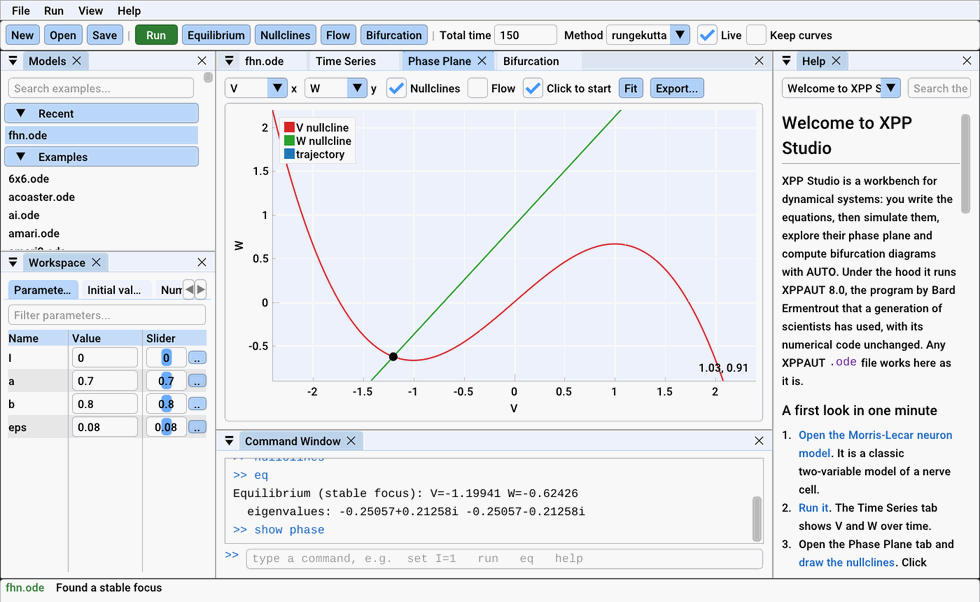
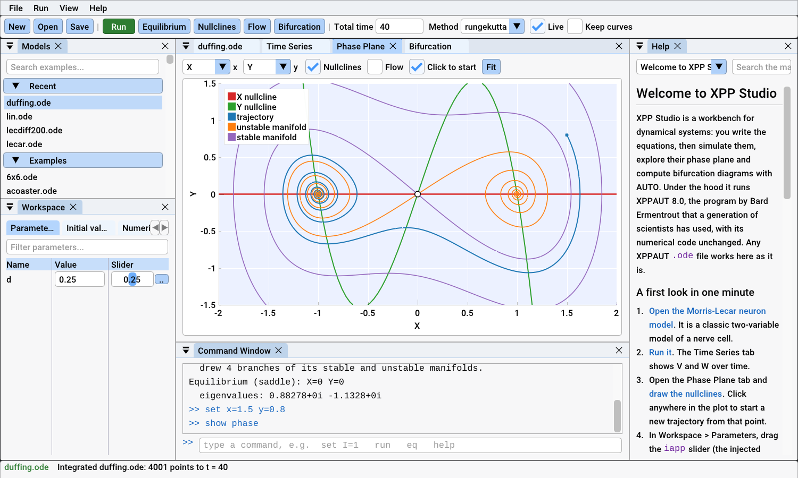
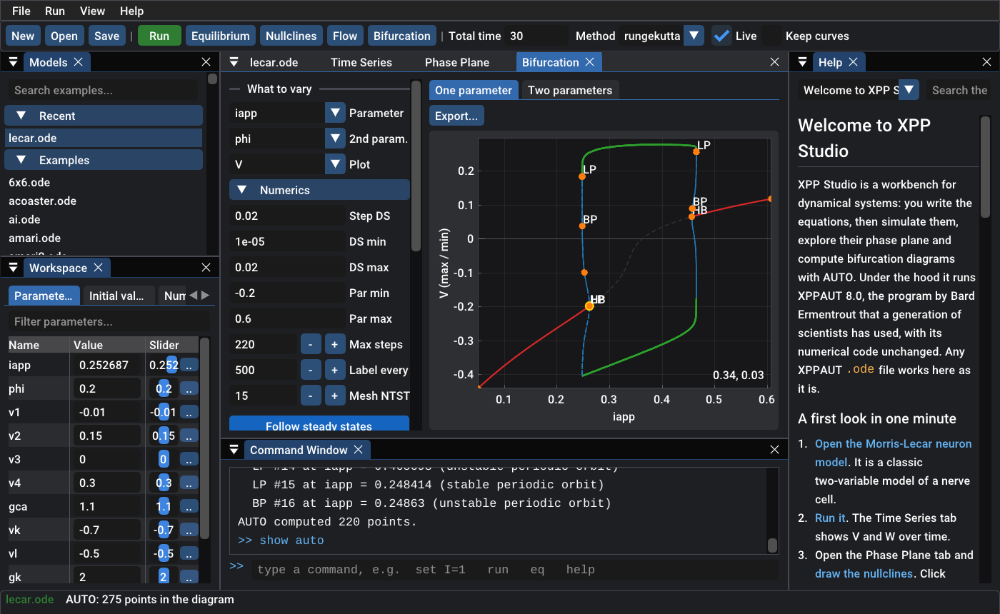
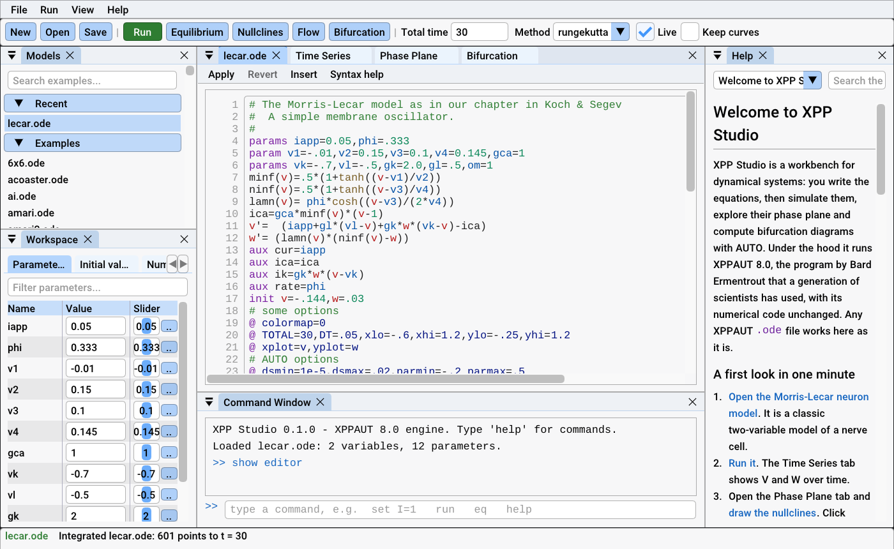
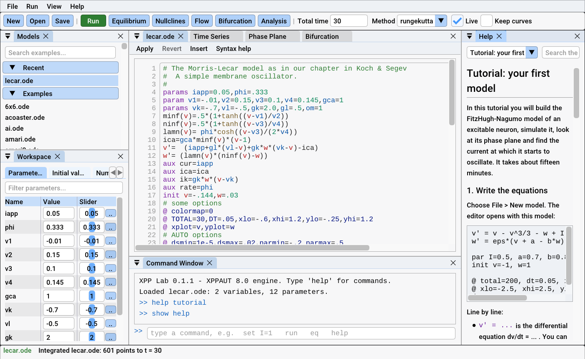

<p align="center">
  
</p>

<h1 align="center">XPP Studio</h1>

<p align="center">
  <b>XPPAUT, modernized.</b><br>
  The trusted XPPAUT and AUTO engine, now a friendly, native app for Windows,
  macOS and Linux, and a Python package.
</p>

<p align="center">
  
  
  
  
</p>

<p align="center">
  
  <br><sub>The FitzHugh-Nagumo neuron as the current <i>I</i> rises: the nullclines
  move, the equilibrium loses stability at a Hopf bifurcation, and the neuron
  starts to fire.</sub>
</p>

---

## If you know XPPAUT, you already know XPP Studio

XPP Studio runs **XPPAUT 8.0's own numerical code**: the same
`.ode` files, the same fifteen integrators, the same AUTO with its HB, LP,
BP, PD and TR labels in the same colours. Even the two-key commands still
work: `I G` integrates, `N N` draws nullclines, `S G` finds an equilibrium.

Everything around the engine is new:

| You want to... | Classic XPPAUT | XPP Studio |
|---|---|---|
| Install it on Windows | Install an X server (Xming), Cygwin DLLs, batch files | Unzip and double-click |
| Run it on a Mac | XQuartz, then Gatekeeper workarounds in the terminal | A native app for Apple Silicon and Intel *(preview)* |
| Change a parameter | Open the Parameters window, type, re-run | Drag its slider; the solution updates live |
| Fix a typo in a model | "Illegal syntax", and XPPAUT exits | The editor points at the line and explains |
| Read a model file | Plain text, any editor | Syntax colouring that knows your parameters and variables |
| Follow a bifurcation | AUTO window, nested dialogs, Grab with the mouse | One panel: a table of special points and the continuations that make sense from each |
| Make a figure for a paper | PostScript, then replot elsewhere | PNG as shown, or a vector SVG, in one click |
| Automate an analysis | Batch mode only (no AUTO) | A command window, and Python with AUTO included |
| Learn it | A book and old web pages | A built-in manual with live examples, and tooltips everywhere |

## Made for teaching

Learning XPPAUT and AUTO has always meant fighting the interface before
the mathematics. XPP Studio removes that first wall:

- **Nothing to install** on Windows. The first start opens a classic model
  (Morris-Lecar) so there is something to explore at once.
- **A guided tutorial inside the app.** Its links open the models and run the
  steps ("draw the nullclines", "find the equilibrium") as you read.
- **Every setting explains itself.** Hover over DS, NTST or Par max in the
  bifurcation panel to see what it does and when to change it.
- **Plain words.** Special points read "Hopf bifurcation" or "fold of limit
  cycles", and from each point you choose an action such as "Periodic orbits
  from this Hopf point".
- **Simulation and continuation side by side.** A parameter sweep (XPPAUT's
  *Range*) drops brute-force simulation results right onto AUTO's
  diagram, so students can see that the stable branches are what the
  system actually does.
- **More than 150 example models** from neuroscience, ecology, chemistry and
  mechanics, each with its description.

## A look around

<table>
  <tr>
    <td></td>
    <td></td>
  </tr>
  <tr>
    <td align="center"><sub>Phase plane: nullclines, flow, and the stable and unstable manifolds of a saddle</sub></td>
    <td align="center"><sub>AUTO: steady states, Hopf points and periodic orbits (dark theme)</sub></td>
  </tr>
  <tr>
    <td></td>
    <td></td>
  </tr>
  <tr>
    <td align="center"><sub>The editor colours your parameters and variables</sub></td>
    <td align="center"><sub>The built-in manual and tutorial</sub></td>
  </tr>
</table>

## Get it

**Windows.** Download `XPPStudio-<version>-Windows.zip` from
[Releases](https://github.com/CesarPerdomoDiaz/xppstudio/releases), unzip
it anywhere, and run `xppstudio.exe`. Nothing else is needed.

**macOS** (11 or later, Apple Silicon or Intel). Download
`XPPStudio-<version>-Darwin.dmg` from the same page and drag the app to
*Applications*. The preview is not notarized yet, so macOS asks you to
allow it the first time; [TESTING.md](TESTING.md) shows how. No XQuartz
needed. See also the [macOS plan](docs/development/macos.md).

**Linux.** Build from source (below); the engine needs no X11.

**Python.**

```python
import xppstudio as xs

m = xs.load("lecar.ode")              # any XPPAUT model file
m.parameters["iapp"] = 0.1           # parameters are a live dictionary
sol = m.run(total=200)               # NumPy arrays: sol.t, sol["V"]
m.phase_plane("V", "W")              # nullclines, flow, equilibria

m.apply_set("hopf")
d = m.auto.equilibria("iapp")        # AUTO: steady states vs. iapp
orbits = m.auto.continue_from(d.first("HB"), "periodic")
m.auto.diagram.plot("V")             # matplotlib, in XPPAUT's colours
```

The wheel includes the compiled engine, so nothing is compiled on your
machine and AUTO works out of the box. See the
[Python guide](docs/python/quickstart.md).

## Same numbers as XPPAUT

The test suite runs every example model that ships with XPPAUT (197 files)
and checks the output **bit for bit** against unmodified XPPAUT 8.0. On
Linux and macOS, CI builds the original XPPAUT with X11 and compares the
two side by side.

CI also runs every model under AddressSanitizer and Valgrind. The few
changes to XPPAUT's code fix the genuine bugs found that way and while
porting it. Each is commented in the source and listed in
[docs/upstream-issues.md](docs/upstream-issues.md). They explain, among
other things, why continuing AUTO from a labelled point never worked on
Windows, why `delmmult` networks coupled to the wrong variable, and why
`mlvolt.ode` now and then gave a different answer.

## Documentation

- **In the app:** press F1.
- **Getting started:** [Welcome](docs/manual/welcome.md),
  [tutorial](docs/manual/tutorial.md), and
  [bifurcation analysis with AUTO](docs/manual/auto.md).
- **Reference:** [the .ode file format](docs/manual/odefile.md),
  [numerical methods](docs/manual/numerics.md), and
  [commands and keyboard shortcuts](docs/manual/commands.md).
- **For XPPAUT users:** [Coming from XPPAUT](docs/manual/xppaut.md).
- **Python:** the [Python guide](docs/python/quickstart.md).
- **How it works:** [architecture](docs/development/architecture.md).

## Building from source

You need a C compiler and CMake 3.20 or later, plus SDL3 for the app.

**Windows** (MSYS2 UCRT64):

```bash
pacman -S mingw-w64-ucrt-x86_64-{gcc,cmake,ninja,sdl3,python-numpy}
cmake -S . -B build -G Ninja && cmake --build build
ctest --test-dir build
build/app/xppstudio.exe
```

**macOS:** run `brew install cmake ninja sdl3`, then the same CMake commands.

**Linux:** install CMake and a C compiler. For the app, either install SDL3
or configure with `-DXPPS_FETCH_SDL3=ON` to build it from source.

**Python:** run `pip install .` from the repository root. On Windows,
XPPAUT's C code needs GCC or Clang, so put MinGW-w64 on `PATH` and set
`CC=gcc` and `CMAKE_GENERATOR=Ninja` first.

**Packages:** `cpack` in the build folder makes the zip, `.dmg` or tarball.

## Trying the preview?

Thank you! [TESTING.md](TESTING.md) has a short list of things to try and
explains how to report what you find.

## Credits and licence

XPP Studio is built on **XPPAUT** by G. Bard Ermentrout and contributors
(GPL-2.0-or-later) and on **AUTO** by E. J. Doedel and collaborators (BSD),
as translated to C inside XPPAUT. The interface uses Dear ImGui, ImPlot,
cimgui/cimplot (MIT) and SDL (zlib).

If XPPAUT's methods help your research, please cite G. B. Ermentrout,
*Simulating, Analyzing, and Animating Dynamical Systems: A Guide to XPPAUT
for Researchers and Students*, SIAM, 2002.

XPP Studio is free software under the GNU General Public License, version 2
or later. See [LICENSE](LICENSE).
