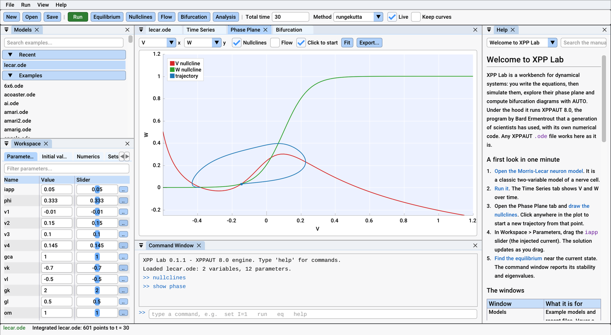
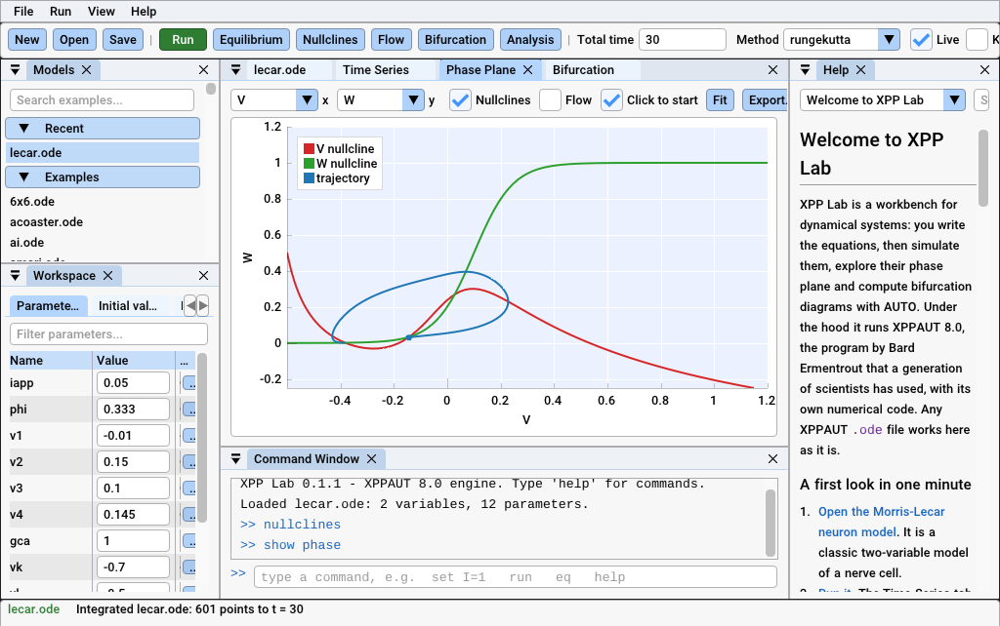

# XPP Lab for macOS: the plan

**Goal:** a student downloads XPP Lab, drags it to *Applications* and
double-clicks it. It opens without a warning on Apple Silicon and Intel
Macs, fits a 13-inch laptop screen and behaves like other Mac apps. No
XQuartz, no Homebrew, no Terminal.

Today's route to XPPAUT on a Mac is to install XQuartz, download a
command-line binary, `chmod` it, allow it in *Privacy & Security*, and then
work in an X11 interface. Most students who struggle with XPPAUT on a Mac
struggle with that, not with the mathematics.

## The first try on a real Mac (24 October 2026)

The maintainer installed the preview `.dmg` on a MacBook Air (Apple M2), dragging
the app to *Applications*. Two things went wrong.

**macOS refused to open the app.** It said Apple could not verify that the
app was free of malware. This was expected: the preview is signed ad hoc
and not notarized. It opened after *Open Anyway* in *System Settings
> Privacy & Security*. Only a Developer ID signature and notarization
remove the warning (step 2 below).

**Once open, the interface was unusable.** The window filled the screen,
but the interface took only its top-left quarter. Most of it was missing:
the toolbar buttons had no labels and the panels were empty, with only a
few tab names showing. The rest of the window was the dark background.
Starting the app with `SDL_RENDER_DRIVER=opengl` instead of Metal changed
nothing, so the renderer was not the cause. There were two bugs, both
about Retina's 2 pixels per point:

1. **The drawing used 1 pixel per point.** ImGui's SDL renderer backend
   scales its clip rectangles from points to pixels by the framebuffer
   scale, but passes the vertices on unscaled. It expects the application
   to set SDL's render scale, as Dear ImGui's own SDL3 example does with
   `SDL_SetRenderScale()`; the app never did. On a Retina screen the shapes
   therefore landed in the top-left quarter of the window, while each
   clip rectangle sat at twice its position, so most of the contents were
   clipped away.
2. **Everything was twice the intended size.** `SDL_GetWindowDisplayScale()`
   returns 2 on a Retina Mac, and `main.c` used it as the interface scale,
   multiplying every ImGui size and the font by 2. The pixel density is
   already handled by ImGui's backend, which uses the same value as the
   framebuffer scale. Text came out 30 points high instead of 15, and the
   panels got the room they would have in a 735 × 478 window. Bug 1 halved
   it all again, which is why the text in the top-left quarter looked
   normal-sized.

CI did not catch either. GitHub's macOS runner has a 1024 × 768 screen at
1×, so its screenshots are 1024 × 642 pixels: the framebuffer scale and the
display scale are both 1, and both bugs vanish. So does Windows, where
window sizes are in pixels.

**The fixes** (branch `macos-plan`):

- `gui_backend_render()` sets SDL's render scale to ImGui's framebuffer
  scale while ImGui draws, then resets it to 1, so screenshots and figure
  export still read pixels.
- The interface scale is the display scale divided by the pixel density
  (`interface_scale()` in `main.c`). That is SDL's display content scale,
  the value Dear ImGui's SDL3 examples use. It is 1 on a Retina Mac at
  default settings.

On Windows both changes leave everything as it was: on a laptop at 125%,
the app window (phase plane and AUTO) and an exported figure are
pixel-identical before and after. At start-up the app also prints one line
to stderr with the window size in points and pixels, the display scale,
the pixel density, the interface scale and the renderer, so a run from
Terminal shows the numbers. On that Windows laptop it reads: display scale
1.25, pixel density 1.00, interface scale 1.25, renderer direct3d11.

**Confirmed on that MacBook Air** the same day, built from this branch. The start-up line read: window 1470x809 (2940x1618 pixels),
display scale 2.00, pixel density 2.00, interface scale 1.00, renderer
metal. The interface fills the window, and text is sharp at full
resolution.

*The fixed app on the M2 MacBook Air (macOS 26.6), shown at half its
2940 × 1618 pixels.*

## What already works

- **The engine needs no X server.** XPPAUT's X11 calls go to a null
  implementation.
- **The app uses SDL3**, which draws with Metal and opens the native file
  panels (NSOpenPanel, NSSavePanel).
- **CI's macOS job** (Apple Silicon, macOS 26) builds everything and builds
  unmodified XPPAUT 8.0 with X11 from Homebrew. It checks that all 197
  example models give the same output with both. It runs the engine and
  Python tests, starts the app for a screenshot, and builds the `.dmg`.
  Apple Clang fuses multiply-adds by default; the build turns that off
  (`-ffp-contract=off`) so the numbers match.
- **The release workflow** builds a universal app (arm64 and x86_64,
  macOS 11 or later). SDL3 is compiled from source because Homebrew's is
  single-architecture. It mounts the `.dmg` and checks the architectures,
  that nothing links outside the bundle, the signature, and that the app
  starts and runs AUTO. That build is on the preview release.
- **`Info.plist`** declares the `.ode` document type (UTI
  `org.xpplab.ode`), marks the app as Retina-capable and sets the
  minimum system version to 11.0.
- **⌘ shortcuts:** ImGui maps its Ctrl shortcuts to ⌘ on macOS (⌘O, ⌘S,
  ⌘N, ⌘Q), and SDL adds the standard application menu (About, Hide, Quit)
  and the Window menu.

*The CI screenshot from GitHub's Apple Silicon runner: a 1× screen, so it
cannot show Retina problems.*

## The work, in order of impact for students

Costs are given in three currencies: money, working time and CI minutes.
macOS runners bill tenfold on this private repository, and GitHub rounds
each job up to a whole minute. Timings measured on 24 October 2026:

| Run | Wall-clock | Billed minutes |
|---|---|---|
| CI, macOS job | 2 min 37 s | 30 |
| CI, whole run (Windows ×2, four Linux jobs, macOS ×10) | 9 min | about 67 |
| Release, macOS job | 3 min 13 s | 40 |
| Release, whole run | 6 min 30 s | about 61 |

So each push that touches code costs about 67 billed minutes, nearly half
of it macOS; GitHub Free includes 2,000 a month. On a public repository
standard runners are free, which ends this cost.

### 1. Draw correctly on Retina — done

The two fixes described above, confirmed on the MacBook Air. CI passed
on the branch.

- **Cost:** one CI run (about 67 billed minutes, 30 of them macOS).

### 2. Open without a warning: Developer ID and notarization

This is the biggest obstacle in a classroom. On macOS 15 and later the way
past the warning is hidden in *System Settings*, and a lab handout that
says "ignore the security warning" is a poor start.

1. **Join the Apple Developer Program:** US$99 (99 €) a year. Enrolment
   as an individual takes a day or two, and users then see the member's
   legal name as the developer. An organization
   account shows the organization's name but needs a D-U-N-S number.
   Apple's fee waiver for educational institutions and nonprofits is for
   organizations that distribute free apps through the App Store, not for
   individuals.
2. **Create a *Developer ID Application* certificate** and export it as a
   `.p12` file. Create an App Store Connect API key for notarization.
3. **Store as repository secrets:** the certificate (base64) and its
   password, and the API key, key ID and issuer ID.
4. **In the release workflow:**
   - import the certificate into a temporary keychain;
   - sign from the inside out (`libxppe.dylib`, SDL, then the app; not
     `--deep`) with `--options runtime --timestamp` and an entitlements
     file;
   - sign the `.dmg`, run `xcrun notarytool submit --wait`, then
     `xcrun stapler staple`;
   - check the result with `spctl --assess -vv`.
5. **Entitlements:** `com.apple.security.cs.disable-library-validation`.
   XPPAUT's `export` statement loads a library the user compiled
   (`dlopen` in `extra.c`). Under the hardened runtime, macOS refuses
   libraries that are not signed by the same team, and a student's own
   library never is. The app's private engine copies would pass: they are
   byte-for-byte copies of the signed library.
6. **Optional saving:** do the signing and notarization on a Linux runner
   with `rcodesign` (apple-codesign), which implements both. Apple's
   notarization queue (usually a few minutes, sometimes much longer) is
   then billed at 1× instead of 10×.

Fix the bundle at the same time: name it `XPP Lab.app` rather than
`xpplab.app`, and ship SDL once (it is in both `Contents/MacOS` and
`Contents/Frameworks`, 3 MB of a 10 MB download).

- **Cost:** US$99 a year, plus about a day of work. Expect a few release
  runs to get it right, each 40 billed minutes plus the notarization wait
  if it runs on macOS. Only releases pay this, not every push.
- Until then, TESTING.md's instructions stay.

### 3. Fit a 13-inch laptop

Most students will have a 13-inch MacBook Air: 1470 × 956 points (M2 and
later) or 1440 × 900 (M1), minus the menu bar and the title bar. At the
right scale the default layout fits, but only just. Even at 1024 points
wide, the CI screenshot shows the toolbar cut off at the right.

- Toolbar: move what does not fit into a » menu instead of cutting it off.
- When the window is narrower than about 1300 points, start with the
  Help panel closed (F1 opens it) and give the plots its column.
- This helps Windows laptops at 150% too.
- **Cost:** half a day to a day. Testable on Windows with `--size`; no
  macOS minutes.

### 4. Things a Mac user notices in the first minutes

- **Follow the system appearance while running.** Today the app reads the
  light or dark appearance only on the first launch. `app_save_settings()`
  writes `dark=` on every quit, and after that the system setting is
  ignored. Many Macs switch automatically at sunset. Add
  *View > Appearance: System, Light, Dark* (default *System*) and handle
  `SDL_EVENT_SYSTEM_THEME_CHANGED`.
- **Ask before quitting with unsaved changes.** *Quit* in the Mac menu
  (⌘Q) reaches the app as `SDL_EVENT_QUIT` and the app quits at once, so
  an edited model is lost. SDL cancels the system's own termination and
  leaves the decision to the app, so the app can ask first. The same
  applies when the window is closed on Windows and Linux.
- **Never write into the app.** Examples open from inside the bundle
  (`Contents/Resources/examples`), and *Save* writes back there:
  - in *Applications* that modifies a signed app, which macOS may then
    report as damaged;
  - run from the `.dmg` or from *Downloads* (App Translocation), the save
    fails.

  Saving an edited example should ask where to put the copy, defaulting to
  a folder in *Documents*.
- **Standard shortcuts:** ⌘W closes the focused panel, and ⌘, opens
  settings. SDL's application menu already shows a greyed-out
  *Preferences…* item that does nothing. Menus say "Cmd+O"; the Mac
  convention is "⌘O", but neither Roboto nor Cousine has the ⌘ glyph, so
  one must be merged into the font atlas from a symbol font.
- **Cost:** one to two days in all. Everything except the ⌘ glyph can be
  tested on Windows and Linux.

### 5. Trackpad gestures in plots

ImPlot zooms on scroll. On a trackpad, the two-finger scroll is how Mac
users move content, and it arrives as many small scroll events, so today a
two-finger swipe zooms in jerks. Mac users expect:

- two-finger scroll to pan the plot;
- pinch to zoom around the pointer, using SDL 3.4's
  `SDL_EVENT_PINCH_BEGIN/UPDATE/END`;
- a mouse wheel to zoom, as now.

SDL does not say whether a scroll came from a trackpad or a wheel, so the
honest design is a setting, *Scroll pans plots (trackpad)*, on by default
on macOS. The 3D view gets the same treatment: drag rotates, pinch zooms.

- **Cost:** one to two days, and someone has to tune it on a real
  trackpad. CI can only check that it builds.

### 6. The Mac menu bar

Mac users look for menus at the top of the screen. Today XPP Lab's
menus are inside the window, and the system menu bar has only SDL's
application and Window menus.

- **A small Objective-C file** (`app/src/mac_menu.m`, a few hundred lines)
  builds File, Edit, Run, View, Window and Help in the system menu bar.
  Each item sends a command-window command (`run`, `eq`, `nullclines`, ...)
  through a queue the frame loop empties, so the menus need no new logic.
- **Hide the in-window menu bar** when the system one exists. That gives
  the plots about 25 points of height on a laptop.
- **Standard items:**
  - *About XPP Lab*, with the version and engine credits;
  - *Settings…* ⌘,: theme, text size and XPPAUT keys, now under View;
  - *Quit* ⌘Q, which asks about unsaved changes;
  - an Edit menu whose Cut, Copy, Paste and Select All reach ImGui's text
    fields. Menu key equivalents catch ⌘C and ⌘V before SDL sees them, so
    this needs care.
- ***File > Open Recent*** goes through `NSDocumentController`, so recent
  models also appear in the Dock icon's menu, and the Help menu gets
  macOS's search field.
- **Cost:** two to three days. Each try needs a Mac: CI can only build it
  and check that the app still starts.

### 7. Remember the window and the session

Today the window opens maximized every time, and `layout.ini` keeps only
the panels.

- Save the window's position, size and full-screen state, and reopen the
  last model, the way MATLAB does. Keep these in `settings.ini` on all
  platforms. Check that the saved position is still on a connected
  display. macOS's own state restoration (`NSWindowRestoration`) is not
  needed for this.
- **Cost:** half a day. Testable on Windows.

### 8. Finder: declared, not yet tried

`Info.plist` declares the `.ode` type, so double-clicking a model, *Open
With* and dropping it on the Dock icon should all work: SDL delivers them
as drop events. No person has tried it yet. Things to check:

- whether macOS registers the type after the first launch from
  *Applications*;
- that a double-click with the app closed opens that model. On a first
  start the app opens `lecar.ode` and then the dropped file, which loads
  the engine twice. That is harmless but slow; skip the example when a
  file arrives in the first frames.
- that Quick Look shows `.ode` files as text: the type conforms to
  `public.plain-text`.
- **Cost:** an hour of code, plus a tester.

### 9. Distribution: Homebrew and Python

- **Homebrew cask.** `brew install --cask xpplab` is how many Mac users
  and lab administrators install apps.
  - Requirements: a public repository (the download URL must be
    reachable) and a notarized app. Homebrew stopped supporting casks
    that fail Gatekeeper on 1 September 2026.
  - Start with a tap: a repository `homebrew-xpplab` holding
    `Casks/xpplab.rb` with the version, URL and SHA-256. The release
    workflow updates it on a Linux runner.
  - Move to homebrew/cask once the project meets its notability rules.
  - **Cost:** an hour, after step 2. No macOS minutes.
- **The Python wheel is a separate route.** `pip install xpplab` gives
  the engine, AUTO and the Python API for scripts and Jupyter, not the
  desktop app. The macOS wheel is universal2, built by cibuildwheel, which
  is already configured to run on tags and by hand. It needs no
  notarization: pip downloads are not quarantined, and the engine library
  carries the ad-hoc signature that Apple's linker adds, which Apple
  Silicon accepts.
  - Publish it to PyPI with the first public release, after a test on an
    Intel Mac.
  - Later, conda-forge, for courses that use Anaconda.
  - **Cost:** one macOS wheel job per release.
- **Not the Mac App Store.** Its sandbox forbids loading user-compiled
  libraries (`export`). Developer ID and notarization give the same smooth
  install without that limit.
- **Updates, later:** an opt-in check of GitHub's releases at start-up, or
  Sparkle.

## Testing without a Mac at hand

What CI on macOS can do:

- build;
- run the goldens and the tests;
- start the app and take a screenshot at 1×.

What it cannot show:

- Retina;
- the trackpad;
- Finder;
- the menu bar;
- Gatekeeper.

The plan:

1. **Catch Retina-type bugs on Linux, cheaply.** Weston's headless
   compositor gives a window whose pixel density is 2, with sizes in points
   as on a Retina Mac:
   `weston --backend=headless --width=1470 --height=956 --scale=2`. A
   screenshot under it in the Linux app job would have caught both bugs.
   The check is the interface scale in the app's stderr line, and the
   screenshot's size against the window's.
   - **Cost:** an hour or two to set up, about a Linux minute per push.
2. **Try a 2× screen on the macOS runner, once, by hand.** List the
   virtual display's modes (`displayplacer list`) and switch to a HiDPI
   one. If one exists, the macOS job takes a second screenshot at 2×.
   - **Cost:** the experiment is about 5 minutes (50 billed). Afterwards,
     about one more minute (10 billed) per push.
3. **Make CI's screenshots easy to read.** Save them as PNG and keep the
   app's scale line in the log.
4. **Spend fewer macOS minutes.**
   - A push to a branch that has an open pull request runs CI twice
     (`push` and `pull_request` are different concurrency groups). Limit
     `push` to `main` and let pull requests cover branches. That saves 30
     billed macOS minutes per push to a PR branch.
   - Run the macOS job only when `engine/`, `app/`, `cli/`, `tests/`, a
     CMake file or the workflow changes.
5. **A person with a Mac.** The maintainer's MacBook Air is the test machine.
   `tests/macos/TEST-PROMPT.md` in the repository is a
   prompt for Claude Code on the Mac. It checks the download and the first
   run, takes screenshots at full Retina resolution, builds from source,
   and reports on a `macos-report` branch without running CI. The checklist
   below is for testers who do it by hand.

### Mac tester checklist

1. **The Mac:** Apple menu > *About This Mac* gives the chip (M1 to M4, or
   Intel) and the macOS version. Is a second screen attached?
2. **Install:** open the `.dmg`, drag the app to *Applications* and open it
   from there. What does macOS say? Take a screenshot (⇧⌘4, then Space,
   then click the window).
3. **The window:** it fills the screen. Text is about the size of Finder's
   and looks sharp, and the toolbar is not cut off. Take a screenshot.
4. **Run from Terminal**
   (`/Applications/xpplab.app/Contents/MacOS/xpplab`) and copy what
   it prints. The line starting `XPP Lab: window` gives the scale.
5. ⌘O shows the standard Mac open panel; open an `.ode` model.
6. Double-click an `.ode` file in Finder, then drop one on the Dock icon.
7. In the phase plane, scroll with two fingers and pinch; if you have a
   mouse, use its wheel. Say what happened.
8. While the app runs, switch *System Settings > Appearance* between Light
   and Dark.
9. Edit the model, press ⌘S, then ⌘Q.
10. Open the app again: is the window where you left it?
11. With a second screen, drag the window across. Text should keep its size
    and stay sharp.
12. Report with the *Feedback* or *Bug report* issue template, with the
    screenshots and the Terminal output.

## Summary

| Step | For students | Work | Money | Billed CI minutes |
|---|---|---|---|---|
| 1. Retina drawing and scale | the app is usable at all | done, confirmed on a Mac | – | one CI run, about 67 (30 macOS) |
| 2. Developer ID, notarization | opens without a warning | about 1 day | US$99 a year | a few release runs of 40+; then per release |
| 3. Fit a 13-inch screen | nothing cut off | 0.5–1 day | – | Windows and Linux only |
| 4. Appearance, quit prompt, save copies, ⌘W ⌘, | no lost work, looks right | 1–2 days | – | Windows and Linux mostly |
| 5. Trackpad | plots move as expected | 1–2 days | – | needs a tester |
| 6. Mac menu bar | menus where Mac users look | 2–3 days | – | needs a tester |
| 7. Window restoration | picks up where it left | 0.5 day | – | Windows |
| 8. Finder | double-click a model | 1 hour | – | needs a tester |
| 9. Homebrew, PyPI | one-line installs | 1 hour each | – | Linux; one wheel job per release |
| CI: Linux 2× screenshot | stops this bug class | 1–2 hours | – | about 1 Linux minute per push |

## What is needed from people

- **A Mac the developers can reach**, to build and take screenshots there.
  A person is needed for anything on the screen itself: Gatekeeper, Finder,
  the trackpad.
- **An Apple Developer account** (step 2), and then the certificate
  and API key as repository secrets.
- **One or two more Mac testers**, ideally one with an Intel Mac. CI runs
  only on Apple Silicon, so no automated check covers Intel.
