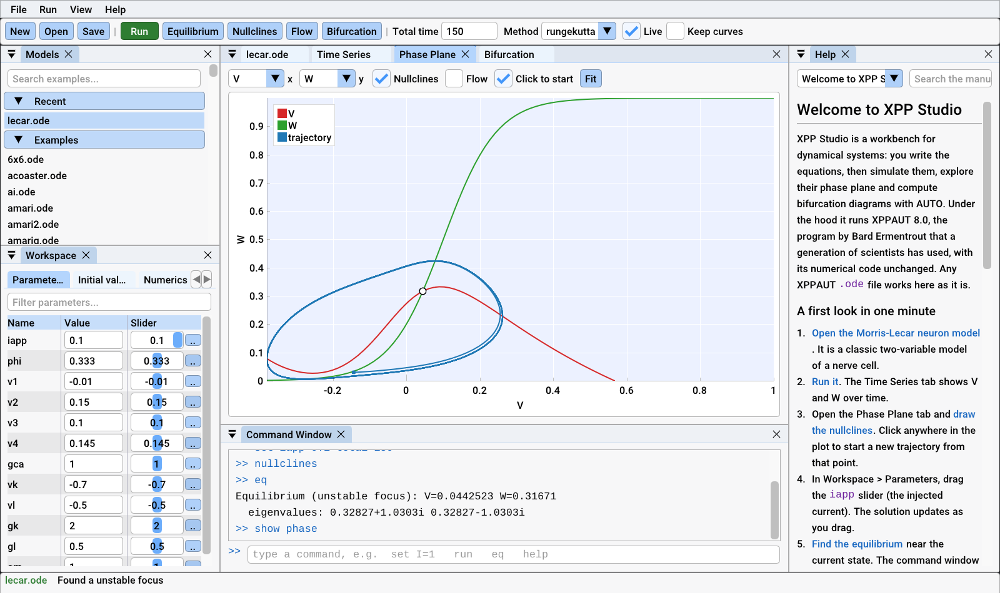
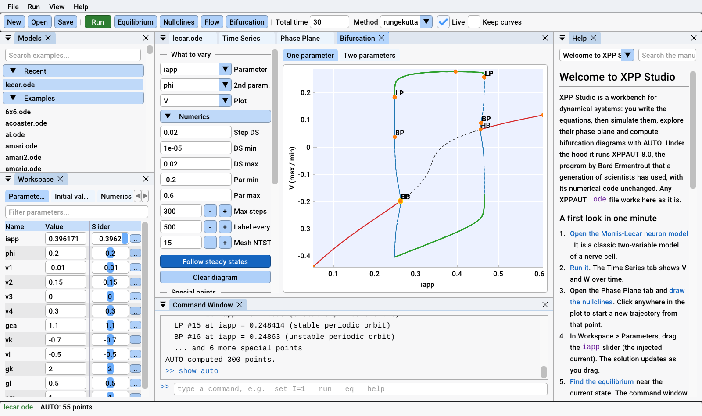

# XPP Studio

**XPPAUT's engine, with a modern interface and a Python package.**

Simulate differential equations, maps, delay and stochastic equations.
Explore phase planes with nullclines and flow. Compute bifurcation
diagrams with AUTO. XPP Studio runs XPPAUT 8.0's numerical code unchanged,
natively on Windows, macOS and Linux, with no X11 server and no Fortran
compiler.



## Two ways to use it

**The desktop app** is a workbench in the spirit of MATLAB. It has
dockable windows, an editor that points at errors, a slider for every
parameter with live re-simulation, interactive plots, a bifurcation
window, a command window and this manual built in.
[Get started with the app](manual/welcome.md).

**The Python package** runs the same engine, AUTO included, from scripts
and notebooks:

```python
import xppstudio as xs

m = xs.load("lecar.ode")
sol = m.run(total=200)
d = m.auto.equilibria("iapp")
m.auto.continue_from(d.first("HB"), "periodic")
m.auto.diagram.plot("V")
```

[Get started with Python](python/quickstart.md).

## Why XPP Studio

- **Your models work.** Any XPPAUT `.ode` file loads unchanged.
- **The numbers are XPPAUT's.** Every example model is checked bit for bit
  against unmodified XPPAUT 8.0.
- **AUTO without the pain.** No Fortran, no build: continuation runs inside
  the app and from Python.
- **Made to be learned.** Tutorials, a full reference, and more than a
  hundred example models in the [gallery](gallery/index.md).


