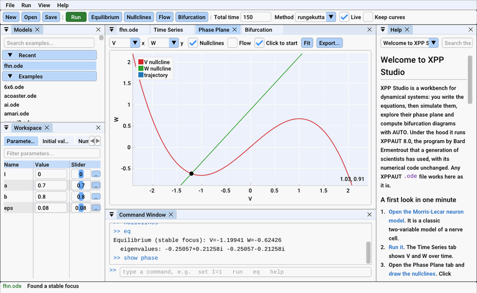
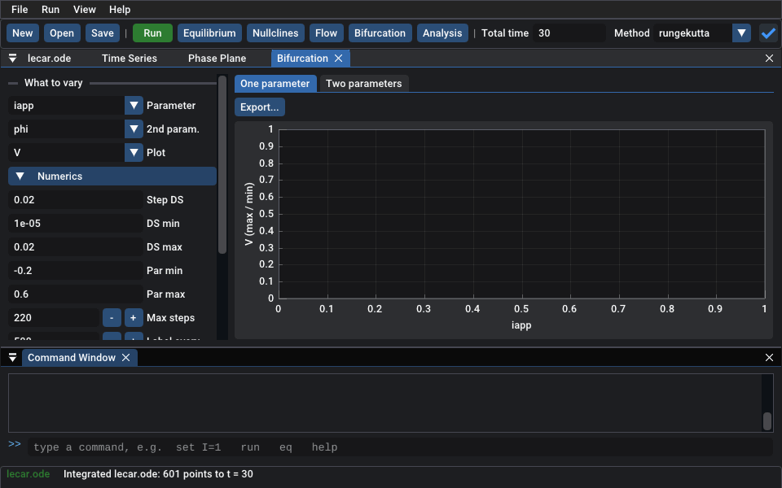

---
hide:
  - navigation
  - toc
title: Home
---

<div class="xl-hero" markdown>

{ .xl-logo }

<h1>XPP Lab</h1>

<p class="xl-tagline">
Simulate differential equations, explore phase planes and compute
bifurcation diagrams. XPPAUT's own numerical code and AUTO, in an app for
Windows, macOS and Linux, and in Python.
</p>

[Download](install.md){ .md-button .md-button--primary }
[Get started in 5 minutes](manual/welcome.md){ .md-button }
[Python](python/quickstart.md){ .md-button }

{ .xl-demo }

</div>

## What do you want to do?

<div class="grid cards" markdown>

-   **Simulate a model**

    ---

    Write the equations, press Run, and drag a parameter's slider while the
    solution follows.

    [Tutorial: your first model](manual/tutorial.md)

-   **Understand a phase plane**

    ---

    Nullclines, the flow, equilibria and their manifolds, on a model of a
    neuron.

    [Tutorial: why does a neuron fire?](manual/neuron-tutorial.md)

-   **Compute a bifurcation diagram**

    ---

    Follow steady states and periodic orbits with AUTO, and read the
    special points.

    [Bifurcation analysis with AUTO](manual/auto.md)

-   **Use it from Python**

    ---

    The same engine, AUTO included, in scripts and notebooks:
    `pip install xpplab`.

    [Python quick start](python/quickstart.md)

-   **Start from a classic**

    ---

    The Lorenz attractor, Chua's circuit, the van der Pol oscillator,
    predator and prey, the heat equation: twenty familiar systems, ready to
    run. Then worked examples by field, from neurons to a kite.

    [Gallery](gallery/index.md) · [Learn by example](learn/index.md)

-   **Look something up**

    ---

    The commands and shortcuts, the `.ode` file format, the numerical
    methods and the Python API.

    [Commands and shortcuts](manual/commands.md)

</div>

## Coming from another tool?

<div class="grid cards" markdown>

-   **XPPAUT**

    ---

    Your `.ode` files load unchanged, the numbers are the same bit for bit,
    and the two-key commands still work.

    [Coming from XPPAUT](manual/xppaut.md)

-   **MATLAB**

    ---

    A workbench with a command window, a workspace and figures, and `.mat`
    files to take your results back.

    [Coming from MATLAB](manual/matlab.md)

-   **AUTO-07p**

    ---

    The same continuation code, without Fortran or constants files.

    [Coming from AUTO-07p](manual/auto07p.md)

</div>

## Why XPP Lab

- **Your models work.** Any XPPAUT `.ode` file loads unchanged.
- **The numbers are XPPAUT's.** Every example model is checked bit for bit
  against unmodified XPPAUT 8.0.
- **AUTO without the pain.** No Fortran, no build: continuation runs inside
  the app and from Python.
- **Made to be learned.** Tutorials, a full reference, and a
  [gallery](gallery/index.md) of classic models, from the Lorenz attractor
  to the heat equation, each ready to run.

```python
import xpplab as xs

m = xs.load(xs.example("lecar.ode"))  # or the path of any .ode file
sol = m.run(total=200)
d = m.auto.equilibria("iapp")
m.auto.continue_from(d.first("HB"), "periodic")
m.auto.diagram.plot("V")
```


