# Aerospace: a kite on a tether

A kite held by a single line is one of the nicest problems in nonlinear
mechanics: two equations, one parameter you feel on your face (the wind),
and almost every idea of a course on dynamical systems. Steady flight is an
equilibrium that exists only above a minimum wind; it is stable only above a
second, higher wind, where a Hopf bifurcation takes place; the periodic
orbits born there are unstable, and they bound the set of disturbances the
kite survives. Real flight adds limits the equations do not know: the kite
must stay above the ground, and the tether can pull but not push.

This page works through the whole analysis, the way a laboratory session
on the problem goes: the model, its equilibria and their stability, the
bifurcation diagram, the periodic orbits and their Floquet multipliers, the
tension in the tether, the invariant manifolds of the saddle, which flights
survive, and how the minimum wind scales with the kite's size. Each step is
done in the desktop app and in Python, and ends with a figure ready for a
report.

The theory follows *Mecánica analítica* by F. J. Sanz Recio and
G. Sánchez Arriaga, cited as **[MA]**, which uses the kite as a running
example from its first chapter to its last: the Lagrangian model
[MA Box 1.10, pp. 14–20], its dimensionless form [MA Box 6.5, p. 120], the
volume of the state space [MA Box 8.11, pp. 203–204], the equilibria
[MA Box 8.15, pp. 209–210], their stability [MA Box 8.16, pp. 211–217],
the Hopf bifurcation and the periodic orbits [MA ch. 9, Examples 5, 6 and
8, pp. 226–230], and the basin of attraction [MA Box 9.6, p. 241]. The book
is in Spanish; the [references](#references) are at the end. The book's
kite has slightly different aerodynamic coefficients from the one here; the
reasoning is the same, and the numbers here are those of this model.

## The model

**Geometry.** The kite flies in the vertical plane that contains the wind.
Its tether, of length `L`, is straight and fixed to the ground, so the kite
moves on a circle and one angle describes its position: the elevation `Γ`
of the tether above the horizontal. The bridle holds the kite's chord at a
right angle to the tether, so the kite's attitude follows from `Γ` too: the
model has one degree of freedom [MA Box 1.10 (1/5), p. 14]. The tether is
a holonomic constraint, `R = L`; with `Γ` as the generalised coordinate,
its force, the tension, does no virtual work and drops out of Lagrange's
equation [MA Box 1.10 (2/5) and (4/5), pp. 17 and 19].

**Lagrangian.** With the mass `m` at the kite, the kinetic energy is
`T = m L² Γ'²/2` and the potential of the weight `U = m g L sin Γ`. The
aerodynamic force is not potential; it enters through its generalised
component `Q_Γ = L (F_A · u_Γ)`, its projection on the direction of
increasing `Γ` times the lever `L` [MA Box 1.10 (3/5), p. 18]. Lagrange's
equation `d/dt(∂L/∂Γ') − ∂L/∂Γ = Q_Γ` with `L = T − U` gives

```
m L² Γ'' = − m g L cos Γ + L F_A,Γ
```

**Aerodynamics.** The air moves past the kite at the wind's velocity minus
the kite's: along the circle `u = L Γ' + V_W sin Γ`, and along the tether
`w = V_W cos Γ`. The angle of attack is `α = atan2(w, u)`, the dynamic
pressure `q = ρ (u² + w²)/2`, and lift and drag follow a simple law for a
flat kite: `C_L = C_L,max sin 2α`, and a drag polar `C_D = C_D0 + k C_L²`.
Lift is normal to the relative wind and drag along it; their component
along the circle is `F_A,Γ = q S (C_L sin α − C_D cos α)`, and along the
tether `F_A,R = −q S (C_L cos α + C_D sin α)`.

**The tension.** The tether's force appears once the constraint is
relaxed: with `R` as a second coordinate, Lagrange's equation for `R`
gives the multiplier, the tension [MA Box 1.10 (5/5), p. 20]. For a tether
of constant length,

```
T = m L Γ'² − m g sin Γ − F_A,R
```

A real tether only pulls: the model holds while `T > 0`.

**Dimensionless form.** Measure time in units of `sqrt(L/g)` (3.19 s for a
100 m tether), so `τ = t sqrt(g/L)` [MA Box 6.5, p. 120], the wind by
`sqrt(g L)`, `Ṽ_W = V_W/sqrt(g L)`, and the kite by one number,
`Λ = ρ S L / (2 m)`. With `' = d/dτ`,

```
Γ'' = − cos Γ + Λ Ṽ_A (C_L w_A − C_D u_A)
T/(m g) = Γ'² − sin Γ + Λ Ṽ_A (C_L u_A + C_D w_A)
u_A = Γ' + Ṽ_W sin Γ,   w_A = Ṽ_W cos Γ,   Ṽ_A = sqrt(u_A² + w_A²)
```

The state is `(Γ, Γ')`. The kite of this page has `L = 100 m`,
`m = 1 kg`, `S = 4 m²`, `ρ = 1.225 kg/m³`, `C_L,max = 1.2`, `C_D0 = 0.06`
and `k = 0.12`, so `Λ = 245`.

The divergence of the flow is `∂f/∂Γ'`, which is not zero: aerodynamic
forces depend on the velocity, so areas in the phase plane grow or shrink
[MA Box 8.11, pp. 203–204]. That is what allows attracting equilibria and
limit cycles, which a Hamiltonian system cannot have.

In the model file `gam` is `Γ` in radians and `om` is `Γ'`. The wind `VW`
is in m/s and converted inside. `deg` shows the elevation in degrees and
`tens` the tension `T/(mg)`. The three global flags stop a run at the
ground, overhead, or when the tether goes slack, but only when `stop = 1`:
by default the equations run on past those limits, which is useful to see
where an orbit would go.

```ode
# kite.ode
# A kite on a tether of constant length L, in a vertical plane.
# gam: elevation of the tether (rad); om: d(gam)/d(tau), tau = t*sqrt(g/L).
# VW: wind (m/s); lam = rho*S*L/(2*m).
par VW=8, lam=245, stop=0
par L=100, g=9.81, CLmax=1.2, CD0=0.06, kd=0.12
vt=VW/sqrt(g*L)
ua=om+vt*sin(gam)
wa=vt*cos(gam)
va=sqrt(ua^2+wa^2)
alpha=atan2(wa,ua)
cl=CLmax*sin(2*alpha)
cd=CD0+kd*cl^2
tn=om^2-sin(gam)+lam*va*(cl*ua+cd*wa)
gam'=om
om'=-cos(gam)+lam*va*(cl*wa-cd*ua)
aux deg=gam*180/pi
aux tens=tn
# with stop=1 a run ends at the ground, overhead, or when the tether slackens
global -1 gam {arret=stop}
global 1 gam-pi/2 {arret=stop}
global -1 tn {arret=stop}
init gam=1.309, om=0
@ total=47, dt=0.01, bound=1e6
@ xp=gam, yp=om, xlo=-1.6, xhi=1.6, ylo=-1.5, yhi=1.5
@ ntst=60, nmax=2000, npr=10, ds=-0.01, dsmin=1e-5, dsmax=0.02
@ parmin=1, parmax=10, autoxmin=1, autoxmax=10, autoymin=-1.6, autoymax=1.6
done
```

`g` is gravity, so the elevation cannot be called `G`: XPPAUT does not tell
capitals from small letters. Nor can the tension be `T`, which is time.

```python
import math
import numpy as np
import xpplab as xs

m = xs.load("kite.ode")
DEG = 180 / math.pi
TAU = math.sqrt(100 / 9.81)        # seconds in one unit of tau: 3.193
m.evaluate({"gam": math.radians(78.164), "om": 0})["tens"] * 9.81   # 67.16 N
```

`m.evaluate` gives every column, the tension included, at a state without
running the model.

## 1. Steady flight

**Theory.** An equilibrium has `Γ' = 0` and `Γ'' = 0`. With `Γ' = 0`, the
relative wind is the wind itself and `α = π/2 − Γ`, so `C_L = C_L,max
sin 2Γ`, and the equilibria are the zeros of the residual

```
F(Γ) = − cos Γ + Λ Ṽ_W² (C_L cos Γ − C_D sin Γ)
```

For a strong wind there are two positive zeros, a low and a high flight;
as the wind weakens they approach each other and disappear together. Below
that minimum wind the kite cannot fly steadily at all [MA Box 8.15,
pp. 209–210]. A third zero lies below the horizon, where the kite hangs
under the tether: a mathematical equilibrium, not a flight.

Stability comes from the Jacobian at the equilibrium. For an equation
`Γ'' = f(Γ, Γ')` it is `[[0, 1], [∂f/∂Γ, ∂f/∂Γ']]`, whose eigenvalues solve
`λ² − Δ λ − Ψ = 0` with `Δ = ∂f/∂Γ'` (the aerodynamic damping) and
`Ψ = ∂f/∂Γ` (the restoring force with its sign changed). `Ψ > 0` gives a
saddle; with `Ψ < 0` the sign of `Δ` decides stability, and the sign of
`Δ² + 4Ψ` whether it is a node or a focus [MA Box 8.16 (1/4)–(3/4),
pp. 211–214; §8.2.2 and Box 8.6, p. 197].

**In the app.** Open `kite.ode`. In Workspace > Parameters set `VW` to 2.5.
Type an initial elevation near each flight in Workspace > Initial values
(`gam` = 0.3, then 1.1) and press **Equilibrium** each time: the command
window gives the equilibrium, its eigenvalues and its kind, and the phase
plane marks it (filled when stable). **All equilibria** in the phase plane
finds every one in its window at once.

The residual is the right-hand side `om'` as a function of `gam` with
`om = 0`. In the Figure window (**View > Figure**), **Add to this panel >
Model function of a variable** with y = `OM'` and x = `GAM` from −1.5708 to
1.5708 draws it; repeat for each wind after changing `VW`, and set each
series' **x scale** to 57.2958 (radians to degrees).

**In Python.**

```python
for vw, guesses in ((1.5, [-1.5]), (2.05, [0.55, 0.8]), (2.5, [0.3, 1.1]),
                    (5, [0.07, 1.33]), (8, [0.03, 1.36])):
    m.set(VW=vw)
    for g in guesses:
        eq = m.equilibrium({"gam": g, "om": 0})
        print(vw, round(math.degrees(eq["gam"]), 2), eq.kind)
# 1.5 -88.13 stable focus
# 2.05 31.9 saddle        2.05 46.57 unstable node
# 2.5 17.15 saddle        2.5 62.66 stable focus
# 5 3.94 saddle           5 76.21 stable node
# 8 1.53 saddle           8 78.16 stable node

fig = xs.Figure(86, 65)
for vw in (1.5, 2.05, 2.5, 5):
    m.set(VW=vw)
    fig[0].curve(m, "om'", "gam", (-math.pi / 2, math.pi / 2), at={"om": 0},
                 scale=(DEG, 1), label=fr"$V_W = {vw:.2f}$ m/s")
fig[0].set(xlabel=r"Elevation $\Gamma$ [deg]",
           ylabel=r"$F(\Gamma; V_W)$", legend="lower right")
fig.save("kite-residual.png", dpi=150)
```

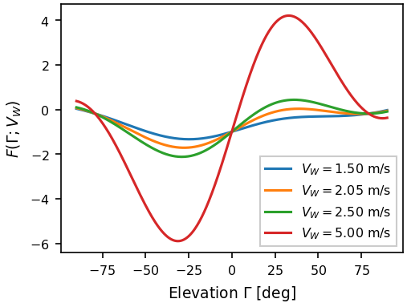

At 1.5 m/s the only zero in (−90°, 90°) is the hanging kite at −88.13°.
At 2.05 m/s two flights exist, both unstable: the lower one is a saddle,
the upper one an unstable node. At 2.5 m/s the upper flight is a stable
focus, and at 5 and 8 m/s a stable node. The lower flight is always a
saddle. As the wind grows the upper flight rises towards 79.28°, where
`C_L cos Γ = C_D sin Γ`: lift and drag balance along the circle and gravity
no longer matters.

## 2. Following the flights: the bifurcation diagram

**Theory.** Following an equilibrium as a parameter changes traces a
branch. Where a real eigenvalue crosses zero, two branches meet and end: a
fold, or saddle-node (LP). Where a pair of complex eigenvalues crosses the
imaginary axis, the equilibrium changes stability and a branch of periodic
orbits is born: a Hopf bifurcation (HB) [MA §9.1.1, pp. 223–224]. For the
kite the fold sets the minimum wind for any steady flight, and the Hopf
point the minimum wind for a stable one [MA ch. 9, Example 5, p. 226].

**In the app.** Set `VW` = 8 and the initial elevation near the upper
flight (`gam` = 1.364). In the Bifurcation window choose Parameter = `VW`
and press **Follow steady states**: the defaults come from the model file
(the step is negative, so the wind decreases). The diagram shows the upper
branch coming down from 8 m/s, a Hopf point, the fold, and the lower
branch going back up. The special points table lists them; click one to
see its values.

**In Python.**

```python
m.set(VW=8, gam=math.radians(78.164), om=0)
d = m.auto.equilibria("VW")
lp, hb = d.first("LP"), d.first("HB")
lp.value, math.degrees(lp.u0["gam"])      # 2.0098 m/s, 39.15 deg
hb.value, math.degrees(hb.u0["gam"])      # 2.2207 m/s, 55.59 deg
2 * math.pi / abs(hb.eigenvalues[0].imag) * TAU   # 22.08 s
```

Positive-elevation flight therefore exists above 2.0098 m/s, and is locally
stable only above 2.2207 m/s. At the Hopf point the eigenvalues are
`±0.908 i`, so small oscillations there last `2π/0.908` time units,
22.08 s.

**A downward sweep.** The diagram shows every equilibrium. What a kite
actually does when the wind drops slowly is a different question, which
the Range answers: start at 8 m/s from 75°, run 150 s (47 time units) at
each wind, step the wind down by 0.1 m/s, and start each run where the
last one ended. In Workspace > Range choose `VW` from 8 to 2 in 61 steps,
**Max / min of a variable** with `GAM`, skip the first third, tick **Start
each run where the last ended** and press **Run range**; the result lies
over the diagram.

```python
values = np.round(np.arange(8, 1.95, -0.1), 10)
m.set(VW=8, gam=math.radians(75), om=0)
trans = 50 / TAU
sweep = m.sweep("VW", values, total=150 / TAU, continue_runs=True,
                measure=lambda s: s["deg"][s.t >= trans].max())
jump = int(np.argmax(np.abs(np.diff(sweep)) > 5))
values[jump], values[jump + 1], sweep[jump]       # 2.5, 2.4, 62.66 deg

fig = xs.Figure(86, 65)
p = fig[0]
p.diagram(d, "GAM", stable=True, periodic=False, scale=(1, DEG), color="k",
          label="Stable equilibrium")
p.diagram(d, "GAM", stable=False, periodic=False, scale=(1, DEG),
          color="#d62728", line="--", label="Unstable equilibrium")
p.line(values, sweep, color="0.5", width=1, label="Numerical integration")
p.set(xlabel=r"Wind velocity $V_W$ [m/s]", ylabel=r"Elevation $\Gamma$ [deg]",
      xlim=(0, 8), legend="lower right")
fig.save("kite-diagram.png", dpi=150)
```

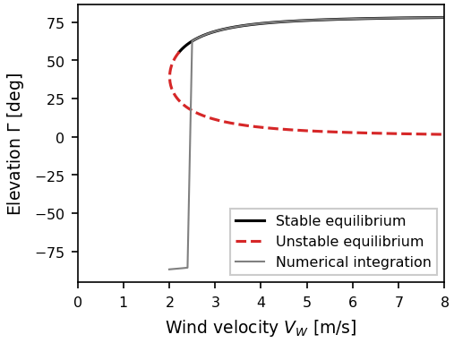

The kite follows the upper flight down to 2.5 m/s, then falls between 2.5
and 2.4 m/s, although the upper flight at 2.4 m/s is still stable. The
wind changed by a finite step: the kite starts the new run at 62.66°, the
old equilibrium, while the new one is near 60.6°. That disturbance is
already too large to recover from, as Step 5 explains; small enough ones
die out.

## 3. Restoring force and damping along the branches

**Theory.** The eigenvalues tell how the flight answers a small push: their
real parts give growth or decay, their imaginary parts oscillation. Along
the upper branch they go from an unstable node to an unstable focus, cross
the imaginary axis at the Hopf point, and become a stable focus and then a
stable node [MA Box 8.16 (4/4), p. 217, Fig. 8.C16c; Fig. 9.2, p. 225].

**In the app.** In the Figure window, **Add to this panel > Bifurcation
diagram** with y = `re1`, `im1`, `re2`, `im2` (the eigenvalues, sorted by
real part, largest first). Untick **XPPAUT's styles**, choose steady states
only, and **from label** 1 **to label** 34: the upper branch from its start
to the fold (the labels are in the special points table; the end points
are EP).

**In Python.**

```python
up = (1, lp.label)                       # the upper branch, start to fold
x, im = xs.figure.diagram_xy(d, "im1", periodic=False, between=up)
focus = x[np.abs(im) > 1e-9]
focus.min(), focus.max()                 # 2.11 and 3.16 m/s

fig = xs.Figure(86, 90, rows=2)
for k, c in ((1, "#1f77b4"), (2, "#d62728")):
    fig[0].diagram(d, f"re{k}", periodic=False, between=up, color=c,
                   label=fr"Re$(\lambda_{k})$")
    fig[0].diagram(d, f"im{k}", periodic=False, between=up, color=c, line=":",
                   label=fr"Im$(\lambda_{k})$")
down = (lp.label, d.labelled()[-1].label)   # the lower branch
fig[1].diagram(d, "re1", periodic=False, between=down, color="#d62728",
               label=r"$\lambda_+ > 0$")
fig[1].diagram(d, "re2", periodic=False, between=down, color="#1f77b4",
               line="--", scale=(1, -1), label=r"$|\lambda_-|$")
fig[0].set(ylabel=r"Upper branch $\lambda$", xlim=(2, 8), ylim=(-6, 6))
fig[1].set(ylabel=r"Lower saddle $|\lambda|$", xlim=(2, 8),
           xlabel=r"Wind velocity $V_W$ [m/s]")
fig.save("kite-eigenvalues.png", dpi=150)
```

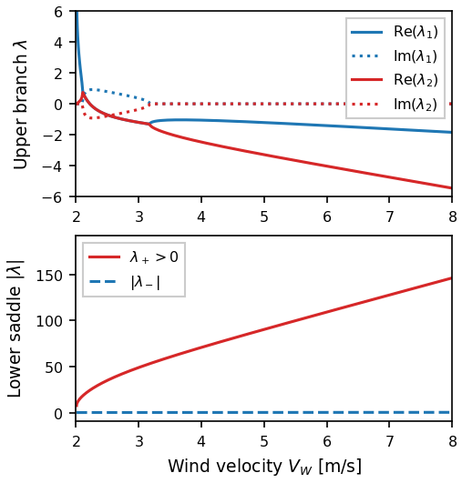

The upper flight is a focus between about 2.1 and 3.2 m/s (the
computed points nearest the changes are 2.11 and 3.16 m/s): there a push
makes it oscillate, growing below the Hopf point and dying out above it.
Above 3.2 m/s it returns without overshoot. On the lower branch one eigenvalue is
positive and large: the saddle repels strongly along one direction.

## 4. Near the Hopf point

A run tells the same story as the eigenvalues. Start 0.12° above the upper
flight, with no angular rate, just below and just above the Hopf wind.

**In the app.** Set `VW` = 2.2006, find the upper equilibrium (`gam` =
0.97, **Equilibrium**), type `gam` 0.0021 rad (0.12°) higher in Initial
values, set the total time to 150 and **Run**; show `DEG` in the Time
Series. Repeat at 2.2306 m/s.

```python
fig = xs.Figure(86, 75, rows=2)
for k, vw in enumerate((2.2006, 2.2306)):
    m.set(VW=vw)
    eq = m.equilibrium({"gam": 0.97, "om": 0})
    sol = m.run(gam=eq["gam"] + math.radians(0.12), om=0, total=150)
    fig[k].run(sol, "T", "deg", color="k", width=1, label=fr"$V_W = {vw}$ m/s")
    fig[k].set(ylabel=r"$\Gamma$ [deg]", legend="upper right")
    print(vw, round(sol["deg"][-1], 2))
# 2.2006 -86.33: the push grows and the kite falls
# 2.2306 55.94: the oscillation dies out
fig[1].set(xlabel=r"Dimensionless time $\tau$")
fig.save("kite-hopf-runs.png", dpi=150)
```

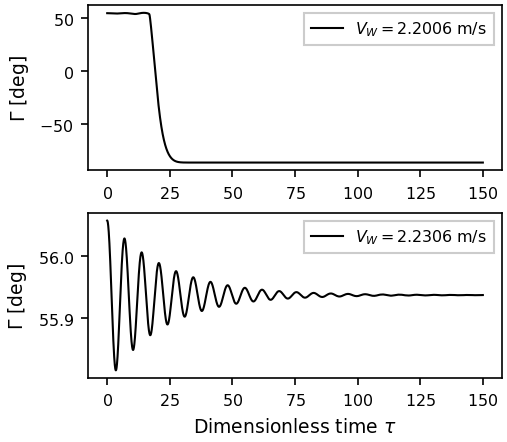

## 5. The periodic orbits

**Theory.** The stability of a periodic orbit is given by its Floquet
multipliers, the eigenvalues of the map that follows a small perturbation
once round the orbit. One of them is always 1 for an autonomous system; the
orbit is stable when the others lie inside the unit circle [MA §9.1.2,
pp. 226–227]. A Hopf bifurcation is supercritical when the orbits are
stable and appear where the equilibrium is unstable, subcritical when they
are unstable and appear where the equilibrium is stable. The kite's is
subcritical: its orbits exist on the side of stronger wind, they are
unstable, and their period grows until the branch ends in a homoclinic
orbit of infinite period through the lower saddle [MA ch. 9, Examples 6
and 8, pp. 227–230]. Such an unstable orbit around a stable focus is the
edge of the focus's basin of attraction [MA Box 9.6, p. 241]: a disturbance
that crosses it is not recovered.

**In the app.** Click the HB point in the special points table, set
**Step DS** to 0.002, **DS max** to 0.002, **Max steps** to 200 and
**Label every** to 1 (so that AUTO keeps every orbit), and choose **Periodic
orbits from this Hopf point**. The orbits appear as their maximum and
minimum elevation. AUTO also flags a few branch points (BP) near the end of
the branch, where the period grows without bound: artefacts of the
homoclinic end, not bifurcations.

For the figures, **Add to this panel > Bifurcation diagram** with y =
`period`, or `GAM` with **XPPAUT's styles** for the Hopf diagram, and
`mu1_abs`, `mu1_re`, `mu1_im` for the multipliers; x = `mu1_re` and
y = `mu1_im` puts them in the complex plane.

```python
orbits = m.auto.continue_from(hb, "periodic", ds=0.002, dsmax=0.002,
                              nmax=200, npr=1)
first = orbits[1]
first.value, first.period * TAU          # 2.2209 m/s, 22.14 s
mu = np.array([abs(p.multipliers).max() for p in orbits if abs(p.point) > 1])
mu.min() > 1                             # True: every orbit is unstable

D = m.auto.diagram
fig = xs.Figure(86, 65)
p = fig[0]
p.diagram(D, "GAM", stable=True, periodic=False, scale=(1, DEG), color="k",
          label="Stable equilibrium")
p.diagram(D, "GAM", stable=False, periodic=False, scale=(1, DEG),
          color="#d62728", line="--", label="Unstable equilibrium")
p.diagram(D, "GAM", periodic=True, scale=(1, DEG), color="#c51b8a",
          line="--", label="Unstable periodic orbit")
p.diagram(D, "GAM", periodic=True, which="min", scale=(1, DEG),
          color="#c51b8a", line="--")
p.set(xlabel=r"Wind velocity $V_W$ [m/s]", ylabel=r"Elevation extrema $\Gamma$ [deg]",
      xlim=(2.1, 2.3), ylim=(54, 57), legend="lower right")
fig.save("kite-hopf.png", dpi=150)

near = ("VW", "max", 2.2, 2.2475)        # leave out the homoclinic end
fig = xs.Figure(86, 65)
fig[0].function("sqrt(1-x^2)", (-1, 1), color="k", line="--", label=r"$|\mu| = 1$")
fig[0].function("-sqrt(1-x^2)", (-1, 1), color="k", line="--")
fig[0].diagram(orbits, "mu2_im", x="mu2_re", where=near, line="none",
               marker="o", markersize=4, color="#1f77b4", label=r"$\mu_2 \approx 1$")
fig[0].diagram(orbits, "mu1_im", x="mu1_re", where=near, line="none",
               marker="s", markersize=3, color="#c51b8a", label=r"$\mu_1$")
fig[0].set(xlabel=r"Re$(\mu)$", ylabel=r"Im$(\mu)$", xlim=(-1.2, 3.2),
           ylim=(-1.6, 1.6), equal=True, legend="lower right")
fig.save("kite-floquet.png", dpi=150)
```

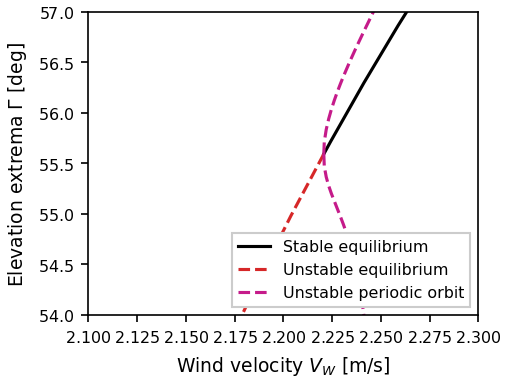

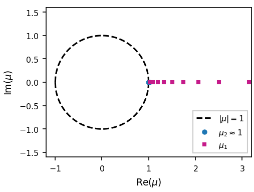

The first orbit, at 2.2209 m/s, has a period of 22.14 s, close to the
22.08 s of the eigenvalues at the Hopf point. The orbits are born on the side where the
upper flight is stable, and one multiplier is real and above 1 on every one
of them: the Hopf bifurcation is subcritical. Close to 2.2207 m/s the
unstable orbit is small and the stable flight recovers only from small
disturbances; the larger the wind, the larger the region it encloses.

## 6. The tension in the tether

**Theory.** The tension follows from the state (see *The model*). At an
equilibrium it is a single number; along a periodic orbit it swings
between a minimum and a maximum. Where the minimum drops below zero the
orbit would need the tether to push: it is still a solution of the
equations, but no longer a possible flight.

**In the app.** The Bifurcation diagram source of the Figure window takes
`aux` quantities too: y = `TENS` gives the tension at every equilibrium and
its maximum (or minimum) over every orbit. **where** keeps only some
points: `figure diagram period orbits where TENS min 0 inf` in the command
window draws the period of the orbits that stay taut.

**In Python.** `m.auto.along("tens", D)` computes the tension along the
diagram; `model=m` lets a figure do it.

```python
ten = m.auto.along("tens", orbits)
vw_t, lo_t, hi_t = (ten[c][~np.isnan(ten["min"])] for c in ("VW", "min", "max"))
slack_at = int(np.argmax(lo_t < 0))
vw_t[slack_at - 1], vw_t[slack_at]       # 2.2458 and 2.2462 m/s
lo_t[1] * 9.81, hi_t[1] * 9.81           # 4.02 and 4.99 N

inf = float("inf")
taut, slack = ("TENS", "min", 0, inf), ("TENS", "min", -inf, 0)
fig = xs.Figure(86, 65)
fig[0].diagram(orbits, "period", where=taut, model=m, color="#c51b8a",
               marker="o", markersize=3, label="Taut orbit")
fig[0].diagram(orbits, "period", where=slack, model=m, color="0.5", line="--",
               marker="x", markersize=3, label="Slack (mathematical only)")
fig[0].set(xlabel=r"Wind velocity $V_W$ [m/s]", ylabel=r"Period $T_\tau$",
           xlim=(2.22, 2.25), ylim=(6, 11), legend="upper left")
fig.save("kite-period.png", dpi=150)

fig = xs.Figure(86, 100)
p = fig[0]
p.diagram(D, "TENS", stable=True, periodic=False, model=m, color="k",
          label="Stable equilibrium")
p.diagram(D, "TENS", stable=False, periodic=False, model=m, color="#d62728",
          line="--", label="Unstable equilibrium")
p.diagram(D, "TENS", periodic=True, model=m, color="#c51b8a", line="--",
          label="Periodic orbit: max and min")
p.diagram(D, "TENS", periodic=True, which="min", model=m, color="#c51b8a",
          line="--")
p.set(xlabel=r"Wind velocity $V_W$ [m/s]",
      ylabel=r"Normalized tether tension $T/(mg)$", xlim=(2, 8), ylim=(-0.2, 7.2),
      legend="upper left")
inset = fig.inset(0, (0.5, 0.08, 0.45, 0.4))
for s in p.series:
    inset.line(s.x, s.y, color=s.color, line=s.line, width=s.width)
inset.set(xlim=(2.2, 2.25), ylim=(-0.1, 1.4), title="Near Hopf")
fig.save("kite-tension.png", dpi=150)
```

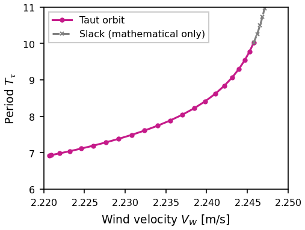

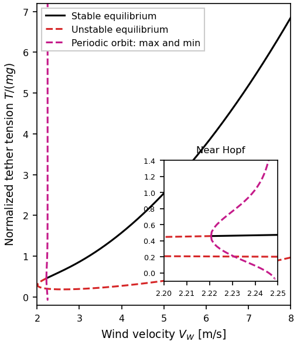

The tension of the first orbits swings between 4.02 and 4.99 N; the
swing widens with the orbit until, near 2.246 m/s (between the orbits
computed at 2.2458 and 2.2462 m/s), its minimum reaches zero. Beyond that the orbits need a pushing tether. The stable flight
stays taut everywhere: 67.16 N at 8 m/s.

## 7. Leaving the saddle: invariant manifolds

**Theory.** The lower flight is a saddle: one eigenvalue is positive, one
negative. Its unstable manifold, the two orbits that leave it along the
unstable eigenvector, shows where a kite slightly off that flight goes. An
orbit that leaves one equilibrium and arrives at another is heteroclinic;
one that returns to the same equilibrium is homoclinic [MA §9.1.3,
pp. 228–229].

**In the app.** Workspace > Many runs > **Shoot from an equilibrium**:
set the initial elevation near the saddle (`gam` = 0.3 at 2.5 m/s), a step
off of 1e-5, a time of 55, unstable directions, and press **Shoot**. The
runs appear in the phase plane, coloured by direction. At 2.05 m/s also
shoot from the upper flight (`gam` = 0.8): it is an unstable node, and both
of its real directions are followed.

```python
m.set(total=55)
for vw, guess in ((2.5, 0.3), (5, 0.07), (2.05, 0.55)):
    m.set(VW=vw, gam=guess, om=0)
    runs = m.shoot()
    print(vw, [round(s["deg"][-1], 2) for s in runs])
# 2.5 [62.66, -85.56]: one side climbs to the stable focus
# 5 [76.21, -81.64]: the same, now a stable node, without overshoot
# 2.05 [-86.73, -86.73]: both fall below the horizon

m.set(VW=2.5, gam=0.3, om=0)
runs = m.shoot()
eqs = [m.equilibrium({"gam": g, "om": 0}) for g in (-1.5, 0.3, 1.1)]
fig = xs.Figure(120, 50, cols=3)
for k, s in enumerate(runs):
    fig[0].run(s, "deg", "om", width=1)
    fig[1].run(s, "T", "deg", width=1, color=fig[0][k].color)
    fig[2].run(s, "T", "om", width=1, color=fig[0][k].color)
ex = [math.degrees(e["gam"]) for e in eqs]
fig[0].line(ex, [0, 0, 0], line="none", marker="x", color="k")
fig[1].line([0, 0, 0], ex, line="none", marker="x", color="k")
fig[0].set(xlabel=r"$\Gamma$ [deg]", ylabel=r"$d\Gamma/d\tau$", ylim=(-1.5, 1.5))
fig[1].set(xlabel=r"$\tau$", ylabel=r"$\Gamma$ [deg]")
fig[2].set(xlabel=r"$\tau$", ylabel=r"$d\Gamma/d\tau$", ylim=(-1.5, 1.5))
fig.save("kite-manifolds.png", dpi=150)
```

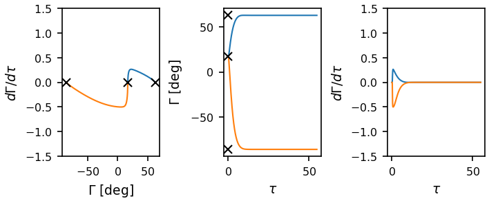

At 2.5 and 5 m/s one branch of the unstable manifold climbs to the upper
flight: a heteroclinic connection from the saddle to the stable flight,
with a small overshoot at 2.5 m/s (a focus) and none at 5 m/s (a node). The
other branch falls through the ground towards the hanging state. At
2.05 m/s every orbit leaving the two flights falls: there is no stable
flight to reach.

## 8. Which flights survive

**Theory.** Local stability is about small disturbances. A real kite meets
large ones, and a flight ends at the ground, overhead, or when the tether
slackens. Sampling many initial states and recording how each run ends
measures the basin of attraction in practice.

**In the app.** Set `stop` to 1 in Parameters, so that the flags end the
runs. Workspace > Many runs: 100 runs, seed 1, `gam` from 0 to 1.5708,
`om` from −1.277 to 1.277 (±0.4 rad/s), **keep where** `TENS` from 0 to
`inf` (only taut starts), and **Run them**. The status bar gives the
counts; the phase plane shows the runs coloured by how they ended.

```python
m.set(total=150 / TAU, stop=1)
for vw in (2.1, 2.23, 8):
    m.set(VW=vw)
    starts = m.sample_initial(100, {"gam": (0, math.pi / 2), "om": (-1.277, 1.277)},
                              require={"tens": (0, float("inf"))}, seed=1)
    runs = m.run_many(starts)
    print(vw, runs.counts())
# 2.1 {1: 51, 3: 49}: half hit the ground (flag 1), half go slack (flag 3)
# 2.23 {1: 50, 3: 50}
# 8 {0: 51, 1: 47, 3: 2}: 51 fly on (0: no flag stopped them)

fig = xs.Figure(86, 65)
names = {0: "No event", 1: "Ground", 2: "Vertical", 3: "Slack tether"}
colors = {0: "#2ca02c", 1: "#d62728", 2: "#1f77b4", 3: "0.3"}
for e in sorted(runs.counts()):
    fig[0].runs(runs, "deg", "om", event=e, color=colors[e], width=0.6,
                scale=(1, 1 / TAU), label=names[e])
fig[0].set(xlabel=r"Elevation $\Gamma$ [deg]",
           ylabel=r"Angular rate $d\Gamma/dt$ [rad/s]", xlim=(0, 90),
           legend="outside")
fig.save("kite-starts.png", dpi=150)
m.set(stop=0)
```

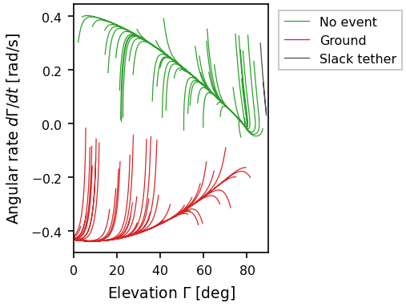

At 2.1 m/s there is no stable flight and every run ends at the ground or
with a slack tether. At 2.23 m/s the upper flight is stable, but the
unstable orbit around it is small: none of the hundred starts lies inside
it. At 8 m/s about half of the starts recover and settle on the upper
flight; the others still fall. A stable equilibrium is no guarantee of
recovery from every taut state.

## 9. The minimum wind for stable flight

**Theory.** The Hopf point can itself be followed in two parameters: the
wind and the kite. With `Λ = ρ S L/(2 m)` as the second parameter, AUTO
traces the curve of Hopf points, the boundary of stable flight.

**In the app.** In the Bifurcation window set **2nd param.** to `lam`,
click the HB point, and choose **Two-parameter curve of Hopf points**. The
Two parameters tab shows the curve. In the Figure window add the diagram
with y = `VW` and x = `lam`, and set the series' **y scale** to
0.0319275 = 1/sqrt(g L) to make the wind dimensionless; add the formula
`1.109724/sqrt(x)` to compare.

```python
two = m.auto.continue_from(hb, "two-parameter", second="lam", ds=0.02,
                           dsmax=0.5, nmax=600, parmin=0.5, parmax=20)
V = 1 / math.sqrt(9.81 * 100)
hb.value * V, 1.109724 / math.sqrt(245)    # 0.07090 and 0.07090
lam, vw = xs.figure.diagram_xy(two, "VW", x="lam")
big = lam > 100
np.abs(vw[big] * V * np.sqrt(lam[big]) / 1.109724 - 1).max()   # below 0.01

fig = xs.Figure(86, 65)
fig[0].diagram(two, "VW", x="lam", scale=(1, V), label="Hopf points")
fig[0].function("1.109724/sqrt(x)", (30, 10000), color="k", line="--",
                label=r"$1.109724/\sqrt{\Lambda}$")
fig[0].line([245], [hb.value * V], line="none", marker="*", markersize=9,
            color="#d62728", label="This kite")
fig[0].set(xlabel=r"Dimensionless parameter $\Lambda$",
           ylabel=r"$\tilde{V}_{W,H}$", xlim=(0, 10000), ylim=(0, 0.4))
fig.save("kite-scaling.png", dpi=150)
```

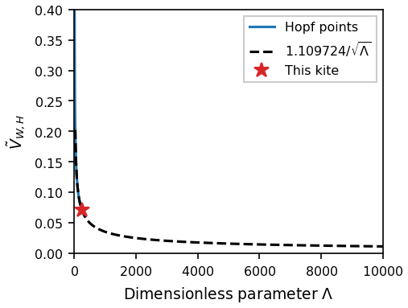

The dimensionless minimum wind falls as `1/sqrt(Λ)`: `Ṽ_W,H ≈ 1.11/sqrt(Λ)`.
In dimensional terms `V_W,H ≈ 1.11 sqrt(2 m g/(ρ S))`: a lighter kite, or a
larger one, flies stably in a lighter wind, and the tether's length drops
out, because it appears both in `Λ` and in the scale of the wind.

## Figures for a report

Every figure on this page can be made in the desktop app as well. The
Figure window holds a page of panels; **Export... > Add to the Figure
window** in any plot starts one, and the sources above add series to it.
Labels take mathtext (`Elevation $\Gamma$ [deg]`), every series its colour,
line, marker and scale, and **PDF...**, **SVG...**, **EPS...** or **PNG...**
writes the file at the page's size. Everything is also written to the
session as the `xs.Figure` calls of this page, so **File > Save session as
Python script** gives the script that makes the same figure. See
[Figures for papers](../manual/figures.md).

!!! note "Exercises"
    1. Double the kite's area (`lam` = 490). Where are the fold and the Hopf
       point now? Compare with the `1/sqrt(Λ)` law.
    2. A kite with more drag, `CD0` = 0.12. Does the high-wind elevation
       rise or fall? Why?
    3. At 2.5 m/s, find the largest kick in `om` from the stable flight
       (at its elevation) that the kite still recovers from. Is it larger
       at 3 m/s?
    4. At 8 m/s, run the hundred starts with `seed` = 2. How much do the
       counts change?

??? success "Solutions"
    1. With `m.set(lam=490)` and the same continuation, the fold moves to
       1.4211 m/s, exactly `1/sqrt(2)` times 2.0098: `Ṽ_W` and `Λ` enter
       the equilibrium condition only as `Λ Ṽ_W²`. The Hopf point moves to
       1.5702 m/s, and the law gives `1.109724/sqrt(490) × sqrt(g L)` =
       1.5702 m/s.
    2. It falls, to 74.85°: at high wind `C_L cos Γ = C_D sin Γ`, so
       `tan Γ = C_L/C_D` drops when the drag grows.
    3. With `stop=1` and `m.run(gam=eq["gam"], om=w)` for `w` growing in
       steps of 0.01, the kite recovers up to `om` = 0.14 at 2.5 m/s, and
       up to 0.46 at 3 m/s: farther from the Hopf point, the unstable orbit
       around the flight is larger.
    4. With seed 2: 49 fly on, 48 hit the ground and 3 go slack. A
       hundred samples give the fractions to a few per cent.

## References

- **[MA]** Sanz Recio, F. J. and Sánchez Arriaga, G. (2019). *Mecánica
  analítica: lagrangiana, hamiltoniana y sistemas dinámicos*. Madrid:
  McGraw-Hill/Interamericana de España. ISBN 978-84-486-1539-0 (print),
  978-84-486-1541-3 (electronic). In Spanish. The kite problem runs
  through Boxes 1.10, 6.5, 8.11, 8.15, 8.16 and chapter 9 (Examples 5 to 8);
  chapters 8 and 9 give the theory of stability, bifurcations and periodic
  orbits used here.
- Strogatz, S. H. (2024). *Nonlinear Dynamics and Chaos: With Applications
  to Physics, Biology, Chemistry, and Engineering*, 3rd edition. Boca
  Raton: CRC Press (Chapman & Hall). ISBN 978-0-367-02650-9. Chapter 8 for
  Hopf bifurcations, subcritical ones included, and homoclinic
  bifurcations of cycles.
