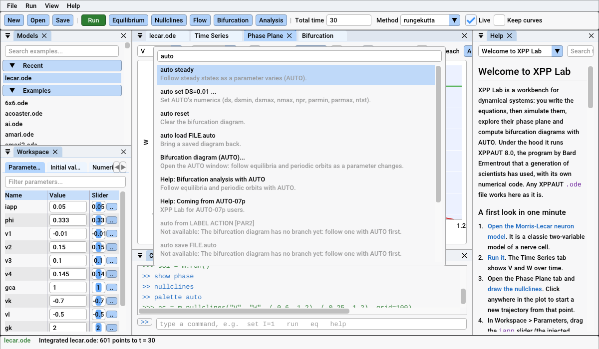

# Commands and keyboard shortcuts

## Keyboard shortcuts

| Keys | Action |
|---|---|
| F5 | Integrate (run) |
| Ctrl+Enter | Apply the edited model |
| Ctrl+O, Ctrl+S, Ctrl+N | Open, save, new model |
| Ctrl+Q | Quit (⌘ instead of Ctrl on a Mac) |
| F1 | Help; over a button, that button's reference page |
| Ctrl+Shift+P | The command palette: find and run any action or command by name (⌘+Shift+P on a Mac) |

## XPPAUT's two-key commands

XPPAUT users drive it with two-letter commands, and those keep working
here whenever the cursor is not in a text field. They can be switched off
under **View > XPPAUT keyboard commands**.

| Keys | XPPAUT menu | Action |
|---|---|---|
| I G | Initial conds > Go | Integrate |
| I L | Initial conds > Last | Start from the end of the last run |
| I S | Initial conds > Shift | The same, and the time goes on |
| N N | Nullcline > New | Draw nullclines |
| N E | Nullcline > Erase | Hide nullclines |
| N F | Nullcline > Freeze | Keep the nullclines drawn |
| K C, K A, K R | Kinescope > Capture, Autoplay, Reset | Capture a figure, play the frames, empty the Kinescope |
| D D | Dir.field > Direct field | Toggle the direction field |
| S G | Sing pts > Go | Find an equilibrium |
| C C | Continue | Integrate further from the end of the last run |
| E | Erase | Clear kept curves |
| W F | Window > Fit | Fit the plots (or double-click a plot) |
| F Q | File > Quit | Quit |

## The command palette

Ctrl+Shift+P (or **View > Command palette...**) opens a search box over the
main window, with every menu action and every command of the command
window. Type words of the name or of the description, in any order:
`export mat`, `nullclines`, `liapunov`. Enter runs the best match as its
menu item or command would. See [palette](../reference/palette.md).



## The command window

Type a command and press Enter; the Up and Down arrows recall earlier
commands. `help` lists every command with a line about it, `help NAME`
prints one's summary, and `doc NAME` opens its reference page: every form
of the command, worked examples, each setting, and what to do when it
fails. The [reference index](../reference/reference.md) lists the commands
by area:

- **Models and values**: [open](../reference/open.md),
  [new](../reference/new.md), [save](../reference/save.md),
  [set](../reference/set.md), [get](../reference/get.md),
  [whos](../reference/whos.md), [use](../reference/use.md),
  [sets](../reference/sets.md), [ic](../reference/ic.md).
- **Running**: [run](../reference/run.md),
  [continue](../reference/continue.md), [ic last](../reference/ic-last.md),
  [click](../reference/click.md), [range](../reference/range.md),
  [many](../reference/many.md), [ensemble](../reference/ensemble.md),
  [bvp](../reference/bvp.md).
- **The phase plane**: [nullclines](../reference/nullclines.md),
  [dirfield](../reference/dirfield.md), [eq](../reference/eq.md),
  [eq all](../reference/eq-all.md), [shoot](../reference/shoot.md).
- **Bifurcations with AUTO**: [auto steady](../reference/auto-steady.md),
  [auto from](../reference/auto-from.md), [auto set](../reference/auto-set.md),
  [auto save](../reference/auto-save.md), [auto load](../reference/auto-load.md).
- **Analysing a run**: [mean](../reference/mean.md),
  [hist](../reference/hist.md), [spectrum](../reference/spectrum.md),
  [fourier](../reference/fourier.md), [xcorr](../reference/xcorr.md),
  [prc](../reference/prc.md), [hfun](../reference/hfun.md),
  [fitdata](../reference/fitdata.md).
- **Control design**: [linearize](../reference/linearize.md),
  [poles](../reference/poles.md), [lqr](../reference/lqr.md),
  [locus](../reference/locus.md), [closedloop](../reference/closedloop.md).
- **Plots, figures and files**: [export](../reference/export.md),
  [figure](../reference/figure.md), [annotate](../reference/annotate.md),
  [view3d](../reference/view3d.md), [ani](../reference/ani.md),
  [kinescope capture](../reference/kinescope-capture.md).
- **Python**: [script](../reference/script.md), [echo](../reference/echo.md),
  [py](../reference/py.md), [python](../reference/python.md),
  [serve](../reference/serve.md).

## MATLAB `.mat` files

`export` writes a MATLAB file when the name ends in `.mat`, for everything
it writes as CSV (Python: `to_mat(path)` beside `to_csv(path)`). MATLAB's
`load` reads it with no toolbox: `s = load("run.mat"); plot(s.t, s.V);
s.params.iapp`. The variables in each file, and how column names are made
valid MATLAB names (`V max` becomes `V_max`), are on the
[export](../reference/export.md#more-about) page.

## Your session as Python

Each action that changes the model or computes something is also written in
the command window, in green after `>>>`, as the line of Python that does
the same with the [xpplab package](https://cesarperdomodiaz.github.io/xpplab/python/quickstart/):

```
>>> m = xs.load("lecar.ode")
>>> sol = m.run()
>>> m.parameters["iapp"] = 0.1
>>> sol = m.run()
>>> m.auto.equilibria("iapp")
>>> m.auto.continue_from(2, "periodic")
```

**File > Save session as Python script** (or `script session.py`) saves
the lines so far as a script that repeats the session's computations
number for number, exported files included. See
[script](../reference/script.md) and [echo](../reference/echo.md).

## Python in the command window

Click the `>>` before the command line (it becomes `py>`), or type `py`,
and the line takes Python instead of commands; `:cmd` goes back. `m` is
the model open in the app, `app` the app, `xs` and `np` the package and
NumPy:

```
py> m.parameters["iapp"] = 0.1
py> sol = m.run(total=200)
py> np.max(sol["V"])
np.float64(0.26150020956993103)
py> eq = m.equilibrium(); eq.kind
'unstable focus'
```

The Python runs in a process of its own, so an endless loop or a crash
never stops the app. See [py](../reference/py.md). When no Python with
NumPy is found, the command window offers **Install Python** (`python
fetch`), which installs XPP Lab's own Python with NumPy and Matplotlib,
about 55 MB to download, once; see [python](../reference/python.md).

## Command-line options

The desktop app takes a model file and these options:

```
xpplab [model.ode] [options]
```

With no model, it opens `lecar.ode` from its examples the first time it
starts.

| Option | Action |
|---|---|
| `--cmd "command"` | Run a command-window command after start-up. Repeat it to run several (up to 32), in order. |
| `--then "command"` | Run a command a few frames later, once the windows have been drawn, for example to export a figure. Repeatable, up to 32. |
| `--screenshot file.png` | Draw a number of frames, save the window to the file and exit. A name ending in `.png` gives a PNG; any other name gives a BMP. |
| `--frames N` | How many frames `--screenshot` draws before it saves (default 12), or how many frames `--record` saves. |
| `--size WxH` | Window size in pixels (default `1500x920`). |
| `--reset-layout` | Put the windows back in their default places instead of the saved layout. |
| `--record DIR` | Save `--frames` frames as `DIR/frame_00000.png`, `DIR/frame_00001.png`, ... and exit. |
| `--fps N` | Frames a second of a recording (default 20). Time in the app runs at this rate however long each frame takes to save, so animations stay smooth. |
| `--script FILE` | Run commands at given frames of a recording. Each line is `FRAME command`; lines starting with `#` are comments. |
| `--at FRAME "command"` | Run one command at a given frame of a recording. Repeatable. |
| `--log FILE` | Write the command window's text to the file when the app exits. |
| `--no-serve`, `--serve` | Start without the channel through which Python drives the app (the Python guide's *Driving the desktop app*); a screenshot or recording opens it only with `--serve`. |

Frames for `--at` and `--script` count from the first saved frame, which is
frame 0. A command written `@command` runs without being echoed in the
command window. Screenshots and recordings always start from the default
layout and do not save it. If one fails, the error is written to a file
named after it with `.err` added, for example `s.png.err` or `frames.err`.
The app then exits with status 1; a run that works exits with 0, so scripts
and CI can tell the two apart. The folder for `--record` must already exist.

Take a screenshot of the phase plane after a run:

```
xpplab lecar.ode --cmd run --cmd "show phase" --screenshot s.png
```

Record five seconds at 20 frames a second. The script `demo.txt`:

```
# frame command
0 set iapp=0.1
10 run
40 show phase
60 @nullclines
```

and the command:

```
xpplab lecar.ode --record frames --fps 20 --frames 100 --script demo.txt
```

The frames in `frames/` can be turned into a video or an animated GIF with
any tool; `tools/make_demo.py` does this for the README.

## Without a window: xpplab-batch

`xpplab-batch`, next to the app (inside the app bundle on macOS:
`xpplab.app/Contents/MacOS/xpplab-batch`), runs models from a terminal,
a script or a scheduled job. Without commands it is XPPAUT's `-silent`
mode: it runs the model and writes `output.dat`, the same numbers
`xppaut -silent` writes.

```
xpplab-batch lecar.ode
xpplab-batch lecar.ode -outfile run.dat
```

With commands it speaks the command window's language, AUTO included.
Give them with `-c`, or one per line in a file (lines starting with `#`
are comments); `-c` commands run after those of the files.

```
xpplab-batch lecar.ode -c "set iapp=0.1" -c run -c "export run.csv"
xpplab-batch lecar.ode analysis.txt --script analysis.py
```

where `analysis.txt` could hold:

```
# a brute-force diagram, then AUTO's
use hopf
range iapp 0 0.5 50 V
export range.csv range
auto set parmax=0.6 nmax=220
auto steady iapp
auto from 2 periodic
export diagram.csv auto
export diagram.svg auto
```

The command window's text goes to the terminal. The first command that
fails stops the run, and `xpplab-batch` exits with status 1 (0 when all
went well, 2 for a mistake in the options), so a script can tell. A `set`
of a name the app does not know prints a note but goes on, since XPPAUT
accepts options the app does not list.

| Option | Action |
|---|---|
| `-c "command"` | Run a command. Repeatable. |
| `-outfile FILE` | Without commands, the file the run is written to (default `output.dat`). |
| `--script FILE.py` | Save the session as a Python script at the end, as *File > Save session as Python script* does. |
| `--echo` | Also print each action as Python (`>>> ...`). |
| `--quiet` | Print only the errors (to the error stream). |
| `--keep-going` | Run every command even after one fails; the exit status is still 1. |

`export FILE.dat` writes a run in XPPAUT's format (8 significant digits,
no header); `.csv` writes every number exactly and `.mat` writes a
MATLAB file. Figures are written as SVG,
the phase plane over the model file's window (`@ xlo=..., xhi=...`) and the
others fitted to the data. PNG figures and the Kinescope need the window.

