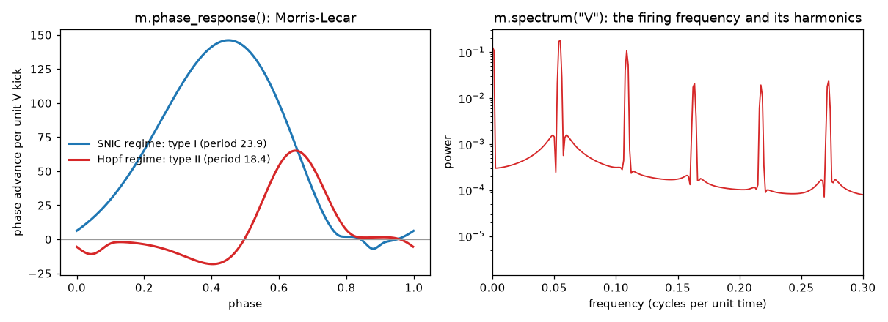

# Data analysis



These are XPPAUT's *Numerics > stocHastic* and *Numerics > Averaging*
tools, run by XPPAUT's own code. Each one analyses the model's **last run**,
as XPPAUT's menus do, and leaves the run unchanged. Most return a
[`Table`](reference.md#xpplab.Table): named NumPy columns, with
`.to_pandas()` and `.plot()`.

```python
import xpplab as xs
m = xs.load("lecar.ode")
m.run(total=400)
```

## Spectra

```python
m.fourier("V")                  # freq, cos, sin: the Fourier series of V
m.power("V")                    # freq, amplitude, phase
m.spectrum("V", length=512)     # Welch power spectral density
m.spectrum("V", "W", kind="coherence", length=256, window="hann")
```

`fourier` and `power` treat the whole run as one period: frequencies are
mode k divided by the length of the run. `spectrum` averages the FFTs of
windows of `length` points that overlap by half (XPPAUT's *Spec.dns*).
`kind` is `"psd"`, `"cross"` (the size of the cross spectrum) or
`"coherence"`; `window` is `"square"`, `"parzen"`, `"hamming"` (the
default), `"bartlett"` or `"hann"`.

## Histograms, correlations, statistics

```python
m.histogram("V", bins=50)                    # bin (left edge), count
m.histogram("V", bins=50, condition="W>0.2") # count only where W > 0.2
m.histogram2d("V", "W", bins=(20, 20))       # x, y, fraction of points
m.correlation("V", lags=100)                 # autocorrelation: lag, correlation
m.correlation("V", "W", lags=100, fft=True)  # cross-correlation by FFT
mean, sd = m.mean("V")
```

Ranges default to the column's range in the run; pass `range=(lo, hi)` to
fix them. The correlations subtract the means (they are covariances) and
give lags in time units.

## Liapunov exponent

```python
m = xs.load("lorenz.ode")
m.run(total=200)
m.lyapunov()                    # about 0.9: chaos
```

The largest exponent by XPPAUT's method. A copy of the state, moved by
`JAC_EPS` (0.001 unless set), is integrated along with it. After each
output step the logarithm of the factor by which the distance between the
two has grown is added up, and the copy is put back at the distance
`JAC_EPS`; the exponent is the sum divided by the time. `lyapunov()` does
this during an integration from the initial conditions, in double
precision, over the same times a run would cover. It stores nothing, so the
last run stays as it was, and after `m.run(...)` it follows the same
trajectory. Keyword arguments are set first, as for `run()`:
`m.lyapunov(total=1000, trans=100)`.

Use a long run that has settled onto the attractor, or skip the start with
`trans`. The result is negative for a stable equilibrium and near zero on a
limit cycle. With a fixed-step method a smaller `jac_eps` (such as 1e-6)
comes closer to the exponent of the linearised equations; with an adaptive
method keep `tol` well below `jac_eps` (CVODE at its default `tol=0.001`
gives nonsense). Models with delays, integrals or noise are refused.

`m.lyapunov(stored=True)` is XPPAUT's own routine (stocHastic > Liapunov),
along the stored last run: each output step is integrated again from a
stored point and compared with the next one. XPPAUT stores runs, times
included, in single precision (about seven digits). Once the time or a
variable is large, the rounding of the stored values and of the step
length is comparable to the perturbation, and that estimate goes wrong:

| Run | `lyapunov()` | `lyapunov(stored=True)` |
|---|---|---|
| `lorenz.ode`, `total=200` | 0.88 | 0.86 |
| `lorenz.ode`, `total=1000` | 0.88 | 7.6 |
| `vdp.ode` (a limit cycle), `total=5000` | -0.001 | -2.5 |
| Forced pendulum, 1500 periods | 0.113 | -0.185 |
| The same with `fold=th` | 0.113 | 1.47 |

The forced pendulum is `th' = p`, `p' = -0.5*p - sin(th) + 1.5*cos(Om*t)`
with `Om = 0.6666667`, `dt` a 500th of the period `2*pi/Om` and
`bound=1e6`, from `th = p = 0`. It is chaotic, with a largest exponent of
about 0.11. In 1500 periods the time reaches 14000, where single
precision keeps only three decimals, while a step is 0.019 long. With
`fold=th` the stored angle also jumps by `2*pi` at each turn.

## Phase response curves

```python
m.apply_set("snic")
m.parameters["iapp"] = 0.09
prc = m.phase_response()
prc.plot("V")                   # against phase, 0 to 1
prc.period                      # 23.87
```

`phase_response` does what XPPAUT users do by hand:

1. Integrate past the transient onto the limit cycle (`transient=`
   defaults to the model's total time).
2. Measure the period from the upward crossings of the first variable (or
   `variable=`), or take `period=`.
3. Integrate exactly one period. This is `m.limit_cycle()`, which leaves
   that period as the run.
4. Compute XPPAUT's adjoint along it: `m.adjoint()`.

Each variable's column is the *infinitesimal phase response curve* to
perturbations of that variable: how much a small kick advances the next
event, per unit of kick, in time units. XPPAUT normalises the adjoint so
that its dot product with the vector field is 1. Divide by `prc.period` for
the phase response in cycles.

In the figure, Morris-Lecar near a saddle-node on an invariant circle
(SNIC) has a type I PRC: kicks only advance it. Near a Hopf bifurcation it
has a type II PRC: early kicks delay it.

## Weakly coupled oscillators: the H function

```python
prc = m.phase_response()
h = m.h_function({"V": "V'-V", "W": "0"})   # gap-junction coupling through V
h.plot()
```

After the adjoint, `h_function` averages the coupling over one cycle to
give the interaction function H(phi) of the phase model
dθ/dt = ω + ε H(θ̂ − θ). Give one formula per variable; primed names
(`V'`) are the other oscillator's variables. For three or more columns the
table also has the odd and even parts, `Hodd` and `Heven`. For two
identical, symmetrically coupled oscillators the phase difference obeys
dφ/dt = −2ε Hodd(φ), so the zeros of `Hodd` where it slopes upward are the
stable phase-locked states.

## Fitting a model to data

```python
fitted = m.fit("recording.dat", variables="V", parameters=["gca", "gk"])
```

Levenberg-Marquardt, as in XPPAUT's *stocHastic > fIt data*. The data are a
file or an array with time in the first column. `variables` are the model
variables to match and `columns` their columns in the data (by default 2,
3, ...). `parameters` lists the parameters, and initial conditions, to
vary. They start from their current values, end at the fitted ones, and
are returned as a dict. The model's initial conditions apply at the first
data time, and XPPAUT integrates from each data time to the next with the
current method, so the data need not be evenly spaced.

## Sensitivity to parameters

```python
m = xs.load("lecar.ode")
m.set(total=10, dt=0.05, meth="rungekutta", iapp=0.1)
s = m.sensitivity(["iapp", "gk"])
s.t               # the output times
s["gk"]           # array (time, variables): d(V, W)/d gk at each time
s["gk"][:, 0]     # d V(t) / d gk
```

The sensitivity S(t) = ∂x(t)/∂p obeys the variational equations
dS/dt = (∂f/∂x) S + ∂f/∂p, with S = 0 at the start (the initial conditions
are held fixed, even if they are written in terms of the parameter). XPP Lab
differentiates the model's formulas, including fixed variables, user
functions and `if(...)then(...)else(...)`, adds the equations to a copy of
the model as new ODEs, and integrates them with the model's own method and
options, from its current parameters and initial conditions. `params` is a
name or a list (default: every parameter). `s.trajectory` is the run of the
augmented model.

Functions that can be differentiated: `sin`, `cos`, `tan`, `exp`, `ln`,
`log` (the natural log, as in XPPAUT), `log10`, `sqrt`, `abs`, `tanh`, `sinh`,
`cosh`, `atan`, `asin`, `acos`, and
`heav`, `sign`, `flr`, `int` and `not` (derivative zero), with `+ - * / ^` and
`if(...)then(...)else(...)`.

Notes:

- With an adaptive method the step is controlled on the sensitivities too, so
  the variables can differ slightly from `m.run()`. With a fixed step the
  times are the same.
- The copy runs with `BOUND` set very high, because the sensitivities of an
  oscillator grow with time and would stop the run at the model's bound.
- Arrays (`x[1..n]'=...`), derived parameters (`!a=...`), tables, delays, maps,
  noise (`wiener`), events (`global`), boundary conditions (`bndry`) and
  functions without a derivative here (`max`, `min`, `atan2`, ...) raise a
  `ValueError` that names the feature. `only` lines are ignored.
- The engine returns single-precision output, so to check a result against
  finite differences of repeated `m.run()` calls use a relative step near
  1e-3; `python/tests/test_sensitivity.py` does this.

## Many noisy runs: the ensemble

```python
ens = m.ensemble(50, total=100)    # XPPAUT's stocHastic > Compute
ens.mean["V"], ens.variance["V"]   # at each time ens.t
ens.std                            # the standard deviation
ens.plot("V")                      # the mean with a band of one sd
ens.to_csv("ens.csv")              # T, V_mean, V_var, W_mean, W_var
```

For models with noise (`wiener`, `ran()`): the runs start from the same
initial conditions while the random numbers go on, so each is different.
The mean and variance are computed by XPPAUT, in single precision, and
equal what its batch mode writes with `@ stoch=1` and `@ stoch=2`. The
last run stays as `m.last_run()`.

## Range: many runs over a parameter

```python
runs = m.sweep("iapp", np.linspace(0, 0.2, 21))              # 21 Trajectories
peaks = m.sweep("iapp", np.linspace(0, 0.2, 21),
                measure=lambda s: s["V"].max())              # an array
lyap = m.sweep("r", np.linspace(20, 30, 31), measure=lambda s: m.lyapunov(),
               continue_runs=True)                           # chaos onset
```

`sweep` is XPPAUT's *Initial conds > Range*. The name can be a parameter or
a variable (its initial value). With `continue_runs=True` each run starts
where the last ended ("Use old ICs" = No), so a branch is followed as the
parameter moves. Each run equals XPPAUT's batch range digit for digit.
`m.ic_last()` alone is XPPAUT's *Initial conds > Last*.

## Boundary-value problems

```python
m = xs.load("cable.ode")    # v'' = v, with bndry v-1 and bndry v'
sol = m.bvp()               # shooting from the initial values as a guess
m.get("VX")                 # the initial slope that solves it
```

For models with `bndry` statements, `bvp()` runs XPPAUT's shooting method
over [T0, T0 + total]. On success the initial conditions hold the solution's
and the solution is returned.

## Animations and 3D

```python
m = xs.load("pend.ode")
m.run(total=20)
ani = m.animation("pend.ani")   # parsed and evaluated by XPPAUT
ani.frame(100)                  # the shapes at row 100: lines, ellipses, ...
ani.plot(100)                   # one frame with matplotlib
ani.save_gif("pend.gif")        # an animated GIF (needs Pillow)

xs.load("lorenz.ode").run().plot3d("X", "Y", "Z")
```

Each shape has its coordinates in the animation's window
(`ani.window`, 0..1 unless the file says `dimension`) and a matplotlib
colour.
