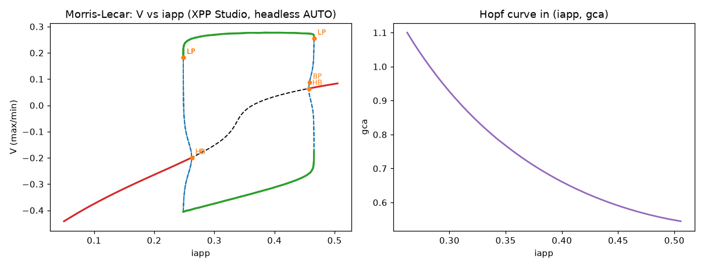

# Bifurcations with AUTO

`model.auto` runs XPPAUT's AUTO continuation. It is the same code XPPAUT's
AUTO window uses, driven by function calls. For the concepts, see
[Bifurcation analysis with AUTO](../manual/auto.md).



## Steady states

```python
m = xs.load("lecar.ode")
m.apply_set("hopf")
d = m.auto.equilibria("iapp", parmax=0.6)
```

`equilibria()` first moves the initial values onto a nearby equilibrium
with Newton's method, then follows it as `iapp` changes. It returns the new
points as a `Diagram`.

## Special points

```python
d.special()          # every labelled HB, LP, BP, PD, TR point
d.special("HB")      # only Hopf points
hb = d.first("HB")
hb.value, hb.parameter, hb.stable
d.label(3)           # the point with label 3
```

Each point carries `multipliers`, as XPPAUT's AUTO window stores them:
exp(λ) for steady states and the Floquet multipliers for periodic orbits.
Either way a point is stable when they lie inside the unit circle. For
steady states, `point.eigenvalues` recovers λ itself. Its real parts are
exact, and its imaginary parts are known modulo 2π.

## Continuing from a point

```python
orbits = m.auto.continue_from(hb, "periodic")        # limit cycles
hopf2 = m.auto.continue_from(hb, "two-parameter", second="gca")
# from a fold (LP) of a model that has one:
# m.auto.continue_from(d.first("LP"), "two-parameter", second="gca")
```

The actions available depend on the point, as in XPPAUT's menus:

| Point | Actions |
|---|---|
| HB | `periodic`, `two-parameter`, `extend`, `new` |
| LP | `two-parameter` |
| BP | `switch`, `extend`, `new`, `two-parameter` |
| PD | `doubling`, `two-parameter`, `fixed-period`, `extend` |
| TR | `two-parameter`, `fixed-period`, `extend` |
| periodic point | `extend`, `fixed-period` |
| steady-state point | `extend` |

An action that does not apply raises a `ValueError` that lists the ones
that do.

## Settings

```python
m.auto.set(ds=0.01, dsmax=0.05, nmax=500, npr=50, parmin=0, parmax=2, ntst=30)
m.auto.settings          # all of them, with xs.auto.SETTINGS explaining each
```

A negative `ds` continues towards smaller parameter values. Settings can
also be passed to `equilibria()` and `continue_from()` as keyword arguments.

## The whole diagram

```python
full = m.auto.diagram       # every point computed so far
full.plot("V")              # max/min of V; full.plot("norm") also works
full.to_pandas()            # one row per point
full.branches()             # {branch number: Diagram}
m.auto.reset()              # start over
```

Plots use XPPAUT's colours: red and black for stable and unstable steady
states, green and blue for stable and unstable periodic orbits. Unstable
branches are dashed, and special points are labelled.
