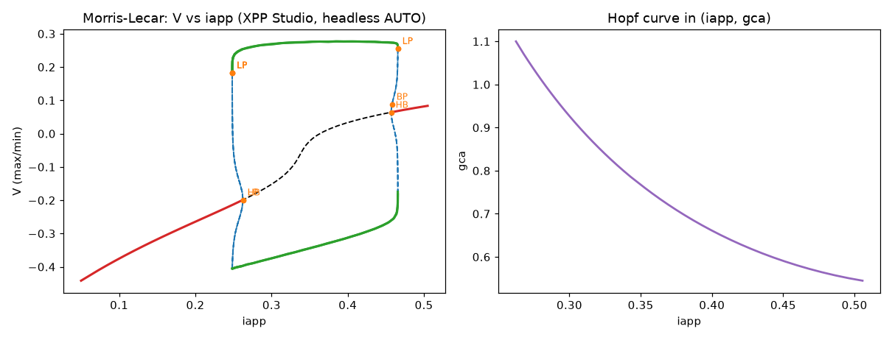

# Bifurcations with AUTO

`model.auto` runs XPPAUT's AUTO continuation. It is the same code XPPAUT's
AUTO window uses, driven by function calls. For the concepts, see
[Bifurcation analysis with AUTO](../manual/auto.md).



## Steady states

```python
m = xs.load("lecar.ode")
m.apply_set("hopf")
d = m.auto.equilibria("iapp", parmax=0.6)
```

`equilibria()` first moves the initial values onto a nearby equilibrium
with Newton's method, then follows it as `iapp` changes. It returns the new
points as a `Diagram`.

## Special points

```python
d.special()          # every labelled HB, LP, BP, PD, TR point
d.special("HB")      # only Hopf points
hb = d.first("HB")
hb.value, hb.parameter, hb.stable
d.label(3)           # the point with label 3
```

Each point carries `multipliers`, as XPPAUT's AUTO window stores them:
exp(λ) for steady states and the Floquet multipliers for periodic orbits.
Either way a point is stable when they lie inside the unit circle. For
steady states, `point.eigenvalues` recovers λ itself. Its real parts are
exact, and its imaginary parts are known modulo 2π.

## Continuing from a point

```python
orbits = m.auto.continue_from(hb, "periodic")        # limit cycles
hopf2 = m.auto.continue_from(hb, "two-parameter", second="gca")
# from a fold (LP) of a model that has one:
# m.auto.continue_from(d.first("LP"), "two-parameter", second="gca")
```

The actions available depend on the point, as in XPPAUT's menus:

| Point | Actions |
|---|---|
| HB | `periodic`, `two-parameter`, `extend`, `new` |
| LP | `two-parameter` |
| BP | `switch`, `extend`, `new`, `two-parameter` |
| PD | `doubling`, `two-parameter`, `fixed-period`, `extend` |
| TR | `two-parameter`, `fixed-period`, `extend` |
| periodic point | `extend`, `fixed-period` |
| steady-state point | `extend` |

An action that does not apply raises a `ValueError` that lists the ones
that do.

## Settings

```python
m.auto.set(ds=0.01, dsmax=0.05, nmax=500, npr=50, parmin=0, parmax=2, ntst=30)
m.auto.settings          # all of them, with xs.auto.SETTINGS explaining each
```

A negative `ds` continues towards smaller parameter values. Settings can
also be passed to `equilibria()` and `continue_from()` as keyword arguments.

## The whole diagram

```python
full = m.auto.diagram       # every point computed so far
full.plot("V")              # max/min of V; full.plot("norm") also works
full.to_pandas()            # one row per point
full.branches()             # {branch number: Diagram}
m.auto.reset()              # start over
```

Plots use XPPAUT's colours: red and black for stable and unstable steady
states, green and blue for stable and unstable periodic orbits. Unstable
branches are dashed, and special points are labelled.

## Auxiliary quantities along a diagram

```python
t = m.auto.along("tension", d)  # d: a diagram, or m.auto.diagram
t.columns     # ['VW', 'min', 'max', 'stable', 'periodic', 'branch', 'label']
```

`along` gives an output column, a variable or an `aux` quantity, at every
point: its value at each steady state, and its minimum and maximum over
each periodic orbit. AUTO keeps whole orbits only at labelled points, so
the other orbit points give NaN; a smaller `npr` before the continuation
labels more of them. Each point's `u0`, `umax`, `umin` and `parameters`
are dicts whose keys ignore case, like the model's own names.

Eigenvalues along a branch of steady states, and Floquet multipliers along
a branch of orbits, are in each point:

```python
lam = [p.eigenvalues for p in d if not p.periodic]
mu = [p.multipliers for p in orbits]
```

## Saving a diagram, and its orbits

```python
m.auto.save("lecar.auto")        # settings, points and AUTO's restart data
m.auto.load("lecar.auto")        # later, or in another session: replaces the diagram
m.auto.continue_from(17, "extend")   # its labelled points carry on as before

sol = m.auto.orbit(6)            # the periodic orbit at point 6, one period
sol.plot("V")
```

The file is XPPAUT's `.auto` format (*AUTO > File > Save diagram*), so
XPPAUT and the desktop app open it too. Numbers are written in full, so a
loaded diagram is the one saved. `orbit()` is XPPAUT's *Import orbit*: the
orbit becomes the model's last run, and the analysis methods use it.

## Boundary value problems, homoclinic and heteroclinic orbits

AUTO's boundary value, homoclinic and heteroclinic starts are
`m.auto.start("bvp", ...)`, `start("homoclinic", ...)` and
`start("heteroclinic", ...)` (see [`Auto.start`](reference.md#xpplab.auto.Auto.start)),
tested against known answers in `python/tests/test_auto_bvp_homoclinic.py`.
The desktop app does not offer them yet.

**Boundary value problems.** Rescale the interval to `[0, 1]`, give one `b`
line per equation, and run the model so that AUTO starts from a solution
that satisfies the conditions. For `x'' = l x`, `x(0) = 0`, `x(1) = 1`:

```python
m.run()                      # the exact solution at l = 1
d = m.auto.start("bvp", "l", nmax=40, ds=0.05)
```

Each point agrees with `x'(0) = sqrt(l) / sinh(sqrt(l))`.

**Homoclinic orbits.** The start continues a long periodic orbit in two
parameters. Find the orbit first: continue periodic orbits from a Hopf point
until the period is large, import one with `auto.orbit(point)`, and put the
model's parameters at that point's values. Then give the saddle:

```python
m.auto.orbit(orbit_point)
m.set(a=orbit_point.value)
h = m.auto.start("homoclinic", "a", second="b", left=[0, 0],
                 unstable=1, stable=1)
```

`left=` is the saddle (and `right=` the second equilibrium of a
heteroclinic start); `unstable=` and `stable=` are the dimensions of its
manifolds. They fill the "Homoclinic info" box XPPAUT shows. The test uses
`x' = y`, `y' = x(1-x) - a y + b x y`: the curve starts where the period of
the orbits diverges and follows `a = 6b/7` for small `b`.

Limits:

- The starting orbit must be close to the homoclinic but not too long. A
  period of about 150 worked. With a period of 12 000 or more in the same
  model, and with a period of 370 in another, the first steps left the
  curve. Start from the first labelled orbit with a long period, not the
  longest.
- The first steps after the start can wobble before AUTO settles on the
  curve (a couple of per cent in the test); the test allows 1% on the
  settled points.
- Only 1-dimensional unstable and stable manifolds in the plane have been
  tested.

**Heteroclinic orbits.** A heteroclinic start continues a connection from the
saddle `left=` to the saddle `right=`. The last run is the first
approximation: a trajectory that leaves the first saddle along its unstable
manifold and arrives near the second; its length becomes the truncation
interval. The test uses the bistable front, `u'' + c u' + u(1-u)(u-a) = 0`:

```python
m.run()   # from near (1, 0) along the front to near (0, 0)
h = m.auto.start("heteroclinic", "c", second="a", left=[1, 0],
                 right=[0, 0], unstable=1, stable=1)
```

The connection from (1, 0) to (0, 0) lies exactly on `c = √2 (1/2 − a)`, and
AUTO's points agree with it to 1e-10 while both ends are saddles
(0 < a < 1), in either direction along the curve and whichever method made
the starting run. The orbit's least `v` matches the front's −1/(4√2).
Two things to watch:

- The starting run must actually leave the first saddle. Started 1e-6 from
  it, CVODE at its default tolerance stays there, and AUTO then finds
  nothing; at TOL = ATOL = 1e-10 it follows the front.
- Past a = 0 the end (0, 0) is no longer a saddle but a node, and the
  continued points drift away from the formula: a saddle-to-saddle
  connection no longer describes the front there.
