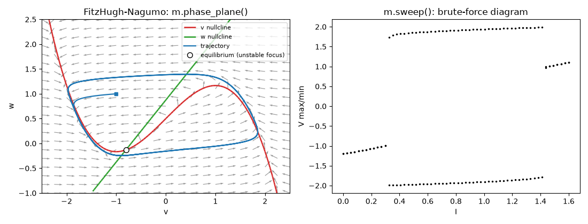

# Phase plane



## One call

```python
ax = m.phase_plane("v", "w", xlim=(-2.5, 2.5), ylim=(-1, 2.5))
```

draws the trajectory, both nullclines, the direction field and the nearest
equilibrium (filled if stable, open if not). Each part can be switched off:
`nullclines=False`, `field=False`, `trajectory=False`, `equilibrium=False`.
Pass `ax=` to draw into your own axes.

## The pieces

```python
xn, yn = m.nullclines("v", "w", (-2.5, 2.5), (-1, 2.5), grid=150)
```

returns two arrays of line segments, each of shape (n, 4) holding
`x1, y1, x2, y2`. They come from XPPAUT's own contouring algorithm. Draw
them with matplotlib's `LineCollection(xn.reshape(-1, 2, 2))`.

```python
X, Y, U, V = m.vector_field("v", "w", (-2.5, 2.5), (-1, 2.5), n=20)
plt.quiver(X, Y, U, V)
```

```python
f = m.rhs({"v": 0.5, "w": 0.2})     # dv/dt and dw/dt at a point
```

In models with more than two variables, the variables not on the axes keep
their initial values.

### Nullclines as a parameter changes

```python
values = np.linspace(0, 0.4, 6)
frozen = m.nullcline_sweep("iapp", values, "V", "W", (-0.6, 1.2), (-0.25, 1.2))
m.phase_plane("V", "W", xlim=(-0.6, 1.2), ylim=(-0.25, 1.2), frozen=frozen)
xs.Table.from_nullclines(frozen, first=1).to_csv("nc.csv")
```

`nullcline_sweep` is XPPAUT's *Nullcline > Freeze > Range*: one
`(x_nullcline, y_nullcline)` pair per value, the parameter put back
afterwards. `phase_plane(frozen=...)` draws such pairs faded behind the
live nullclines. `Table.from_nullclines` lists the segments, one row each
(set, nullcline 1 or 2, x1, y1, x2, y2), as the desktop app's `export
nc.csv nullclines` writes them.

## Equilibria

```python
eq = m.equilibrium()                     # start from the initial values
eq = m.equilibrium({"v": 1.0, "w": 0.5}) # or from a guess
eq.values           # {'V': ..., 'W': ...}
eq.eigenvalues      # complex NumPy array
eq.stable, eq.kind  # False, 'unstable focus'
m.equilibrium(set_initial=True)          # also make it the initial value
```

`kind` is one of: stable node, unstable node, stable focus, unstable focus,
saddle, saddle-focus. For maps it is stable or unstable.

### Every equilibrium, and equilibria over a parameter

```python
eqs = m.find_equilibria(guesses=200, box={"V": (-0.6, 0.6), "W": (-0.1, 0.8)})
eqs                 # <3 equilibria: unstable focus, saddle, stable node>
eqs.to_csv("eqs.csv")

t = m.equilibrium_sweep("iapp", np.linspace(0, 0.3, 31))
t.columns           # ['iapp', 'V', 'W', 'unstable', 'stable']
```

`find_equilibria` is XPPAUT's *Sing pts > Monte Carlo*: Newton's method
from random points in a box (variables left out of `box` span -10 to 10,
XPPAUT's default), keeping each distinct equilibrium. XPPAUT's random
numbers repeat, so the same call finds the same list.

`equilibrium_sweep` is *Sing pts > Range*: at each value the search starts
from the equilibrium found at the value before. The table gives the
numbers of unstable and stable eigenvalues; where no equilibrium was found
the row holds NaN. The parameter is restored afterwards.

### Shooting along eigenvectors

```python
runs = m.shoot({"V": -0.3, "W": 0.0}, eps=1e-5, total=50)
runs.equilibrium        # the equilibrium found from the guess
runs.directions         # [(eigenvalue, +1), (eigenvalue, -1), ...]
```

`shoot` finds the equilibrium, linearises there and integrates from
`x_e ± eps v` along each real eigenvector `v`: those with positive
eigenvalues forward in time (`directions="unstable"`, the default), those
with negative eigenvalues backward (`"stable"`), or both (`"all"`). The
runs trace the start of the invariant manifolds. Unlike `manifolds()`,
which follows XPPAUT and draws them for saddles only, it also follows the
two unstable directions of a node. `m.eigenvector(A, lam)` gives one
eigenvector by XPPAUT's own routine.

